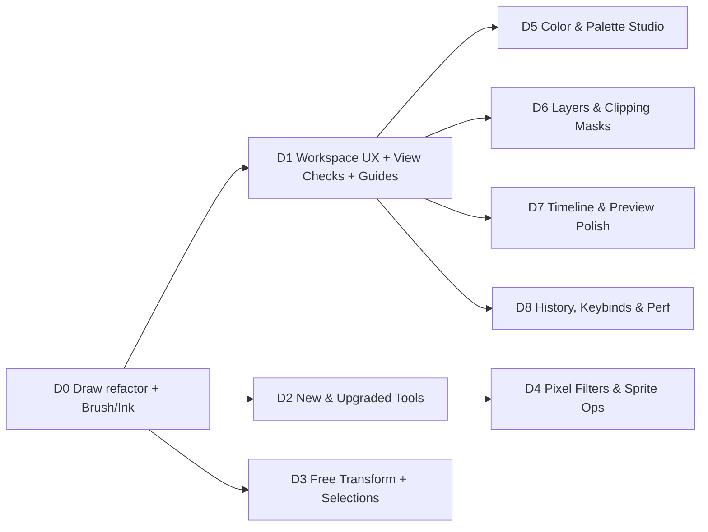

# Pixet — Advanced Pixel Editor (Draw) Workspace: Implementation Plan

> Hand-off document for an implementing agent. Read **§0 Context & Rules** fully before touching code.
> Work milestone by milestone (D0 → D8). Each milestone must end green (all checks in §0.5) and be committed separately on `main`.

---

## 0. Context & Rules

### 0.1 Project
- **Pixet**: pixel-art editor for game devs.
- Stack: **Tauri v2** + Rust workspace (`crates/pixet-core`, `crates/pixet-cli`, `src-tauri`) + **Vite + React 18 + TypeScript (strict) + Zustand + lucide-react**.
- Remote: `origin` → https://github.com/jalatodeguerra/pixet (commit email is configured repo-locally; do not change it).

### 0.2 Existing draw code (read these first)
| File | What it contains today |
|---|---|
| `src/engine/tools/pixelAlgos.ts` | `constrainAngle`, `constrainSquareBounds`, `plotBresenhamLine`, `plotRect`, `plotEllipse` (Zingl), `applyPixelPerfectFilter`, `expandBrushFootprint` (circle only), `expandSymmetry` (fixed center X/Y), `floodFill` (exact RGBA match, 4-connected or global). |
| `src/engine/tools/selection.ts` | `SelectionMask`, marquee/lasso/wand mask builders, `transformBuffer` (flipH/flipV/rotate90). |
| `src/engine/tools/rotate3d.ts` | 3D rotation & turntable sprite rasterizer. |
| `src/engine/document/PixelBuffer.ts` | RGBA `Uint8ClampedArray` pixel buffer, `getPixel`, `setPixel` (with `alphaLock`), `clone`, `isEmpty`. |
| `src/engine/document/PixelEngine.ts` | Cel storage (`layerId:frame`), linked cels, layer compositing (5 blend modes: Normal, Multiply, Screen, Overlay, Add), onion skinning, floating selection, shader preview compositing. |
| `src/engine/document/selectionActions.ts` | Cut/copy/paste, cut/copy to new layer, delete, select all, deselect, commit floating selection, `transformSelectionOrCel`. |
| `src/engine/document/historyActions.ts` | Unified undo/redo coordinator (`UndoCoordinator`) integrating `TileHistory` (64×64 pixel chunks) and map/tileset history. |
| `src/engine/renderer/WebGL2Renderer.ts` | WebGL2 sprite viewport renderer (nearest-neighbor). |
| `src/components/Viewport.tsx` | **~2,063 lines** — still contains all draw-mode pointer handling, shape previews, symmetry lines, selection marching ants, grid/wrap overlays alongside rig/tile delegation. |
| `src/components/ToolRail.tsx` | Draw tool rail with flyout groups (`pencil`/`fillBrush`, `eraser`, `rect`/`ellipse`/`line`/`isoBox`, `fill`, `eyedropper`, `marquee`/`lasso`/`wand`, `move`, `tileStamp`). |
| `src/components/ToolOptionsBar.tsx` | Undo/redo, brush size (1–16px), pixel-perfect, shape fill/outline, fill contiguous/global, selection 90°/flip buttons, symmetry X/Y, pixel/tile/iso grid, seamless wrap. |
| `src/components/RightSidebar.tsx` | **~986 lines** — inline Color/Palette section (HSV picker, auto shading ramp, preset/file import, add color) + Layers section (raster/group/tilemap/rig/data, visibility, lock, opacity, blend mode, drag-reorder, mapRole). |
| `src/components/ColorPicker.tsx` | Canvas-rendered HSV SV-square + Hue strip (no CSS gradients). |
| `src/components/Timeline.tsx` | Frame grid, variable durations, playback loop, onion skin prev/next count, animation tags, cel linking, drag-reorder frames, rig dope/curves view. |
| `src/components/FloatingPreview.tsx` | Draggable 1×/2×/4× animation preview with tag selector and shader preview support. |
| `src/utils/color.ts` & `src/utils/paletteParser.ts` | Hex/HSV/RGBA conversion, `buildShadingRamp`, `.gpl`/`.hex`/`.pal` parsers, built-in presets. |
| `src/store/editorStore.ts` | Global Zustand store (`ToolId`, brush/view toggles, palette, layers, frames, tags). |
| `crates/pixet-core/src/document.rs` & `composite.rs` | `.pixet` document schema, blend modes, and Rust-side compositing/export. |

### 0.3 Current gaps this plan closes
1. `Viewport.tsx` (2,063 lines) and `RightSidebar.tsx` (986 lines) are monolithic for Draw mode; draw logic needs the same clean modularization as `src/components/tiles/` and `src/components/rig/`.
2. Brushes are limited to circle footprints with solid RGBA replacement — no square/diamond/custom brushes, no brush opacity, no ink modes (shading ramp, color replace, dither, alpha blend), and no live brush footprint cursor.
3. Missing essential pixel-art tools: Dither Brush, Pixel Gradient, Bezier Curve, Polygon/Polyline, Shading/Lighten-Darken, Spray/Scatter, Jumble/Smudge, Custom Brush Capture (`Ctrl+B`), Ellipse Marquee, Polygonal Lasso; Bucket/Wand lack tolerance and sample-all-layers.
4. Symmetry is locked to center X/Y; no movable axes, diagonal, or radial symmetry; no rulers, draggable guides, custom grid, reference image overlay, non-destructive Flip View, or Grayscale/Silhouette value checks.
5. No interactive Free Transform (`Ctrl+T`) with RotSprite/Scale2x resampling or skew; no selection boolean ops (add/subtract/intersect) or expand/contract/border/invert/stroke.
6. No pixel-art filters or sprite ops (Auto-Outline, Selective Outline, Drop Shadow, HSV/Brightness-Contrast, Color Replace, Quantize/Dither, Orphan/Hole Cleanup, Auto-Crop/Trim, Offset/Wrap).
7. Color/Palette panel lacks alpha slider, color harmonies, recent colors, swatch reordering/editing/sorting, sprite palette extraction, hue-shifted ramp builder, palette-lock, and indexed live-remap.
8. Layers lack clipping masks, merge down / merge visible / flatten, solo toggle, color tags, and extended blend modes.
9. Timeline/UX lacks cel thumbnails, multi-cel bulk selection, tinted/loop-wrap onion skinning, visual history panel, Command Palette (`Ctrl+K`), and customizable keybindings.

### 0.4 Hard rules
1. **UI style (user-enforced):** flat neutral dark-gray (`#141414`, `#1a1a1a`, `#202020`, `#272727`, `#303030`, accent `#4c8bf5`). **0px border-radius, no `box-shadow`, no `text-shadow`, no `backdrop-filter`, no decorative gradients, no glows.** Reuse classes in `src/styles/layout.css` (`panel-section`, `panel-header`, `panel-collapse-btn`, `panel-body`, `mini-btn`, `icon-action-btn`, `toggle-chip`, `palette-select`). New classes use the `draw-` prefix.
2. **Engine purity:** everything under `src/engine/**` is React-free and imports relatives **with explicit `.ts` extensions** (required by `node --test`).
3. **TypeScript:** `strict`, `noUnusedLocals`, `noUnusedParameters`. No `any`.
4. **Backward compatibility:** old `.pixet` files must load unchanged. Any new persistent metadata (guides, clipping masks, layer color tags, extended blend modes, draw preferences) must default safely when absent.
5. **Pixel-art correctness:** all drawing, transforms, and previews remain crisp nearest-neighbor (no unintended anti-aliasing); RotSprite/Scale2x are opt-in resampling modes.
6. **Do not grow `Viewport.tsx` or `RightSidebar.tsx`:** new draw pointer/overlay logic lives in `src/components/draw/` (D0/D1).

### 0.5 Definition of done (run after every milestone)
```bash
rg -n "box-shadow|text-shadow|backdrop-filter|border-radius:\s*[1-9]" src/styles/   # must print nothing
node --test tests/engine.test.ts tests/draw.test.ts                                   # all pass
pnpm run build                                                                         # tsc && vite build, 0 errors
cargo test --workspace                                                                 # all pass
git add -A && git commit -m "feat(draw): <milestone summary>"
```
Add **new unit tests** for every new engine function in `tests/draw.test.ts` (keep `tests/engine.test.ts` green and unchanged in behavior).

---

## Feature Overview

| Area | Features |
|---|---|
| **Brush & Ink Engine** | Circle/Square/Diamond/Diagonal/Custom brushes (1–64px), brush opacity, Ink modes (Simple, Alpha Blend, Shading Ramp, Color Replace, Lock Alpha, Ordered Dither), live footprint cursor, right-click secondary/erase/pick, `Shift+Click` line connect. |
| **Workspace & View Checks** | Modular `src/components/draw/` panels, Flip View H/V (`H`), Grayscale Value Check, Silhouette Check, backdrop switcher, rulers & snap guides, custom grid, Reference Image overlay, Command Palette (`Ctrl+K`). |
| **Drawing Tools** | Dither Brush, Pixel Gradient (linear/radial + Bayer), Shading/Lighten-Darken (`J`), Quadratic/Cubic Bezier Curve (`C`), Polygon/Polyline (`P`), Spray/Scatter (`S`), Jumble/Smudge, Custom Brush Capture (`Ctrl+B`), Tolerance + Sample-All-Layers Bucket/Wand, Movable/Diagonal/Radial Symmetry, Ellipse Marquee & Polygonal Lasso with Add/Sub/Intersect. |
| **Free Transform & Selections** | Interactive Free Transform (`Ctrl+T`) with scale/rotate/skew/pivot gizmo, Nearest / RotSprite / Scale2x resampling, Invert/Expand/Contract/Border/Stroke/Fill selection, Select Layer Content (`Ctrl+Click` thumb). |
| **Filters & Sprite Ops** | Auto-Outline (4/8-way, inside/outside, selective tinted), Drop Shadow, HSV / Brightness-Contrast, Color Replace (cel/layer/sprite), Posterize & Quantize to Palette (None/Bayer/Floyd-Steinberg), Orphan/Hole Cleanup, Auto-Crop/Trim, Offset/Wrap Canvas, Scale Sprite. |
| **Color & Palette Studio** | Alpha slider, RGB/HSV/HSL inputs, Wheel/SV toggle, Color Harmonies, Recent Colors, swatch drag-reorder/edit/delete/sort, Extract Palette from Sprite (median-cut), Hue-Shifted Ramp Builder, Palette Lock, Indexed Live-Remap. |
| **Layers & Compositing** | Clipping Masks ("Clip to Below"), Merge Down / Merge Visible / Flatten / Clear Cel, 11+ new blend modes (CPU + WebGL2 + Rust), Solo Layer (`Alt+Click` eye), layer color tags, search/filter, bulk eye/lock drag. |
| **Timeline & Preview** | Cel thumbnails, multi-cel range selection & bulk ops, Onion Skin v2 (Red/Blue tint, opacity falloff, in-front/behind, loop-wrap), Reverse frames, Ping-Pong tags, Floating Preview zoom/pan & 1×/2× split. |
| **History, Keybinds & Perf** | Visual scrubbable History Panel, customizable keybindings with Aseprite preset, WebGL2 dirty-rect partial uploads, debounced thumbnails. |



---

## D0 — Draw Architecture Refactor & Brush/Ink Foundation

**Goal:** modularize Draw mode out of `Viewport.tsx` and establish a composable brush + ink pipeline.

### 1. Draw Component Extraction (`src/components/draw/`)
- `src/components/draw/drawTools.ts`: tool registry (`DRAW_TOOL_GROUPS`, `DRAW_TOOL_BY_ID`, `DRAW_TOOL_SHORTCUTS`), matching `tileTools.ts` and `rigTools.ts`.
- `src/components/draw/useDrawPointer.ts`: move draw-mode pointer down/move/up, stroke batching, shape drag, selection drag, and pan/eyedropper modifiers out of `Viewport.tsx`.
- `src/components/draw/DrawOverlay.tsx`: SVG/canvas overlay for pixel-accurate brush footprint cursor, live shape preview, symmetry axis lines, selection marching ants, and guides (D1).

### 2. Brush Engine (`src/engine/tools/brush.ts`)
```ts
export type BrushShape = "circle" | "square" | "diamond" | "diagonalL" | "diagonalR" | "custom";

export interface CustomBrushData {
  id: string;
  name: string;
  width: number;
  height: number;
  pixels: Uint8ClampedArray;
  colorMode: "rgba" | "mask"; // mask tints alpha with active FG color
}

export interface BrushConfig {
  shape: BrushShape;
  size: number;              // 1..64
  opacity: number;           // 1..100
  pixelPerfect: boolean;
  spacing: number;           // 1 = every pixel along Bresenham
  customBrush?: CustomBrushData | null;
}

export function getBrushFootprint(cx: number, cy: number, cfg: BrushConfig): Array<{ x: number; y: number; alpha: number; rgba?: [number, number, number, number] }>;
```

### 3. Ink Modes (`src/engine/tools/ink.ts`)
```ts
export type InkMode =
  | "simple"        // direct RGBA replace (classic pixel art)
  | "alphaBlend"    // Porter-Duff source-over using brush opacity
  | "shadingRamp"   // step destination pixel up/down active ramp
  | "replaceColor"  // only write where dst matches secondaryColor
  | "lockAlpha"     // preserve destination alpha
  | "dither";       // write only where ordered dither matrix passes (D2)

export function applyInkPixel(
  dst: [number, number, number, number],
  src: [number, number, number, number],
  x: number,
  y: number,
  mode: InkMode,
  ctx: InkContext
): [number, number, number, number] | null; // null = no-op
```

### 4. Ergonomics
- **Right-click behavior** setting (`secondaryColor` | `erase` | `eyedropper`, default `secondaryColor`).
- **`Alt` hold** = temporary Eyedropper; **`Shift+Click`** with Pencil/Eraser = straight Bresenham line from previous stroke endpoint.
- **`ToolOptionsBar.tsx`**: add Brush Shape selector, Brush Opacity slider, and Ink Mode selector when a brush tool is active.

**Tests (`tests/draw.test.ts`):** footprints for circle/square/diamond/diagonal/custom at odd & even sizes; `applyInkPixel` for every ink mode (`alphaBlend` math, `replaceColor` match/skip, `lockAlpha`, `shadingRamp` stepping); `Shift+Click` line continuity.

---

## D1 — Focused Draw Workspace UX, View Checks & Guides

**Goal:** declutter `RightSidebar.tsx`, add essential pixel-art inspection modes, guides, reference image, and Command Palette.

1. **Sidebar Modularization (`src/components/draw/`):**
   - Extract `ColorPalettePanel.tsx`, `LayersPanel.tsx`, `BrushPanel.tsx` (presets + saved custom brushes), and `ReferencePanel.tsx` from `RightSidebar.tsx`.
   - Keep `RightSidebar.tsx` as a thin router/container for Draw / Tiles / Rig / Data modes.
2. **Non-Destructive Viewport Inspection Toggles:**
   - Store flags: `viewFlipH`, `viewFlipV`, `viewGrayscale`, `viewSilhouette`, `canvasBackdrop: "checkerDark" | "checkerLight" | "solidDark" | "solidMid" | "custom"`, `canvasBackdropColor`.
   - Shortcuts: `H` toggles Flip View H (`Shift+H` Flip View V). Pointer coordinates inverse-map cleanly when flipped so artists can paint while flipped!
   - Grayscale Value Check & Silhouette Check applied in viewport display shader / 2D pass without touching pixel data.
3. **Rulers, Draggable Guides & Custom Grid:**
   - `GuideLine { id: string; axis: "x" | "y"; pos: number }` stored in document metadata (`draw_ext.guides`).
   - Top & left pixel rulers (toggleable); drag from ruler to create guide, drag off-canvas to delete; `snapToGuides` toggle for shapes/selections/move.
   - Custom Grid (`customGridW`, `customGridH`, `customGridOffsetX`, `customGridOffsetY`) independent of tileset dimensions; pixel grid auto-fades when `zoom < 4`.
4. **Reference Image Overlay (`ReferencePanel.tsx` + `DrawOverlay.tsx`):**
   - Load/paste/drop a reference image (PNG/WebP/JPG) rendered either in a docked/floating reference box or pinned behind/over the canvas with adjustable opacity (10–100%), scale, X/Y offset, lock-input toggle, and direct eyedropper sampling.
5. **Command Palette (`src/components/CommandPalette.tsx`, `Ctrl+K`):**
   - Flat modal with fuzzy search over tools, filters, transforms, layer actions, view toggles, and file commands; shows shortcuts and executes on `Enter`.

**Tests:** flipped viewport coordinate round-trip (`screenToCanvas` ↔ `canvasToScreen` with `viewFlipH`/`viewFlipV`); guide snapping math; fuzzy command matcher.

---

## D2 — New & Upgraded Drawing Tools

**Goal:** complete pixel-art toolset; all rasterization algorithms live as pure functions in `src/engine/tools/`.

### 1. Ordered Dithering (`src/engine/tools/dither.ts`)
- Built-in matrices: `bayer2`, `bayer4`, `bayer8`, `checker`, `diagL`, `diagR`, `dots`, plus user-defined custom bitmask.
- `shouldPlotDither(x, y, threshold01, pattern): boolean`.
- Powers: **Dither Brush** (or `dither` ink mode with mix ratio slider), **Pixel Gradient**, and **Dither Bucket Fill**.

### 2. New Tools
- **Pixel Gradient (`Shift+G`, `src/engine/tools/gradient.ts`):** drag start→end handle; Linear & Radial modes; ordered dithering (Bayer 2×2/4×4/8×8 or None); optional Palette-Snap; respects selection & alpha lock.
- **Shading / Lighten-Darken (`J`):** paints using `shadingRamp` ink; LMB steps lighter/warmer, RMB steps darker/cooler; configurable step count and option to follow either auto hue-shifted ramp or custom palette ramp.
- **Bezier Curve (`C`, `src/engine/tools/curves.ts`):** click-drag endpoints then drag 1 (Quadratic) or 2 (Cubic) control points in `DrawOverlay.tsx`; integer pixel-crisp rasterization (`plotQuadraticBezier`, `plotCubicBezier`) with optional pixel-perfect pass; `Enter` commits, `Esc` cancels.
- **Polygon / Polyline (`P`):** click to place vertices, `Shift` snaps angle to 45° (or 2:1 iso when Iso Grid active), outline or scanline-filled (`plotPolygon`), close on double-click / click first vertex / `Enter`.
- **Spray / Scatter (`S`):** seeded/PRNG scatter inside circular radius with configurable density (1–100%) and optional palette-neighbor jitter.
- **Jumble / Smudge (`Shift+S`):** swaps random pixel pairs within footprint (Jumble) or drags source pixels along stroke vector (Smudge) for organic dithering and texture blending.
- **Custom Brush Capture (`Ctrl+B`):** converts active selection into a `CustomBrushData` brush (`colorMode: "rgba" | "mask"`); `X`/`Y`/`Z` flip/rotate custom brush live; save to `BrushPanel` presets.

### 3. Upgrades to Existing Tools
- **Paint Bucket (`G`) & Magic Wand (`W`):**
  - Add `tolerance` (0–255 Euclidean/Manhattan RGB+A distance), `sampleAllLayers` (reads composited frame, writes active layer), `diagonal8` (8-connected flood), and `ditherFill` option.
- **Symmetry v2 (`src/engine/tools/symmetry.ts`):**
  - Replace fixed center-only `expandSymmetry` with:
    - Movable `symAxisX` / `symAxisY` (float half-pixel supported, e.g., `16.0` or `15.5`, draggable handles on canvas).
    - Diagonal symmetry (`diag45`, `diag135`).
    - Radial / Rotational symmetry (`radialSegments: 2..12` around movable center `(cx, cy)`).
- **Selection Tools:**
  - Add **Ellipse Marquee** and **Polygonal Lasso** to `select-group` flyout.
  - Support boolean selection modes: Replace (default), **Add (`Shift`)**, **Subtract (`Alt`)**, **Intersect (`Shift+Alt`)** across Marquee, Ellipse, Lasso, Polygonal Lasso, and Wand.

**Tests:** Bayer matrix threshold determinism; linear/radial gradient bounds & symmetry; Bezier & polygon rasterization; bucket/wand tolerance + 8-connected + sample-all-layers; movable/diagonal/radial symmetry point expansion; selection boolean union/difference/intersection.

---

## D3 — Interactive Free Transform & Advanced Selections

**Goal:** precision non-destructive pixel transforms before commit.

1. **Free Transform Engine (`src/engine/tools/transform.ts`):**
   - `TransformState { x, y, width, height, scaleX, scaleY, rotationDeg, skewX, skewY, pivotX, pivotY, algorithm: "nearest" | "rotsprite" | "scale2x" }`.
   - Extract/generalize existing RotSprite pixel rotation from `src/engine/rig/` into shared `src/engine/tools/rotsprite.ts` (upscale 3×/8× via EPX/Scale2x → rotate nearest → downscale nearest) so both Rig and Draw share one tested implementation.
   - `applyFreeTransform(src: PixelBuffer, state: TransformState): PixelBuffer`.
2. **Interactive Gizmo (`Ctrl+T` in `DrawOverlay.tsx` + `useDrawPointer.ts`):**
   - Activates on current selection (or active cel non-empty bounds if no selection).
   - 8 bounding-box scale handles (`Shift` lock aspect, `Alt` scale around pivot), corner-exterior rotation handle (`Shift` 15° snap), `Ctrl+Drag` edge skew, draggable pivot crosshair.
   - ToolOptionsBar shows numeric `X`, `Y`, `W`, `H`, `Angle°`, resampling algorithm dropdown, `Apply (Enter)` / `Cancel (Esc)`.
3. **Selection Operations (`src/engine/tools/selection.ts` + `selectionActions.ts`):**
   - `invertSelection()`, `expandSelection(px)`, `contractSelection(px)`, `borderSelection(px)`.
   - `selectLayerContent(layerId, frame)` (`Ctrl+Click` on layer thumbnail).
   - `strokeSelection(width, align: "inside" | "center" | "outside", color)` and `fillSelection(color)`.

**Tests:** identity transform preserves pixels exactly; 90°/180° RotSprite vs Nearest parity; Scale2x 2× upscale correctness; selection invert/expand/contract/border pixel counts.

---

## D4 — Pixel-Art Filters, Adjustments & Sprite Operations

**Goal:** pure pixel-art filter library with live viewport preview modal and single-step undo.

All filters live in `src/engine/tools/filters.ts`, accept `(buf: PixelBuffer, opts, mask?: SelectionMask | null)` and return a new `PixelBuffer`:

1. **Auto-Outline (`applyOutlineFilter`):**
   - `thickness: 1..4`, `connectivity: 4 | 8`, `placement: "outside" | "inside"`, `mode: "solid" | "selective"`.
   - **Selective / Tinted Outline:** derives outline color for each border pixel by darkening + hue-shifting the adjacent opaque pixel (classic modern pixel-art shading technique).
2. **Drop Shadow (`applyDropShadowFilter`):**
   - `offsetX`, `offsetY`, `color`, `opacity`, optional output onto new layer beneath active layer.
3. **Color Adjustments (`applyHsvAdjust`, `applyBrightnessContrast`, `applyColorReplace`, `applyQuantize`):**
   - HSV shift (hue `-180..180`, sat `-100..100`, val `-100..100`).
   - Brightness / Contrast (`-100..100`).
   - **Color Replace:** source RGBA → target RGBA, tolerance `0..255`, scope: *Active Cel / Active Layer / Entire Sprite*.
   - **Posterize & Quantize to Palette:** nearest palette color with `dither: "none" | "bayer4" | "floydSteinberg"`.
   - Invert & Desaturate (luminance).
4. **Pixel Cleanup (`applyPixelCleanup`):**
   - Reuse/extend orphan removal & 1px hole-fill from `src/engine/rig/pixelCleanup.ts` for general Draw use.
5. **Sprite & Canvas Operations (`src/engine/tools/spriteOps.ts`):**
   - **Auto-Crop / Trim:** compute tight non-transparent bounding box across active cel or all layers/frames and resize canvas.
   - **Offset / Wrap Pixels:** shift cel/layer/selection by `(dx, dy)` with wrap-around (interactive drag modal or numeric X/Y) for seamless textures.
   - **Scale Sprite:** resize entire sprite (all layers & frames) via `nearest`, `scale2x`, or `rotsprite`.
6. **UI:** `src/components/draw/FilterModal.tsx` with live canvas preview toggle, scope selector, and Apply/Cancel; accessible from `Sprite > Filters` menu and Command Palette (`Ctrl+K`).

**Tests:** 4-way vs 8-way outline pixel counts; selective outline produces darker neighbor hue; HSV/brightness identity at 0; color replace across tolerance; Floyd-Steinberg & Bayer quantization only emits palette colors; auto-crop bounds; offset wrap round-trip (`+dx` then `-dx` = identity).

---

## D5 — Advanced Color & Palette Studio

**Goal:** upgrade color picking and palette management for pixel artists.

1. **Color Picker Upgrades (`src/components/ColorPicker.tsx`):**
   - Add **Alpha slider** (0–255) alongside Hue strip.
   - Compact **RGB / HSV / HSL** numeric inputs toggle.
   - **Color Wheel** mode toggle alongside SV Square (canvas-rendered, no CSS gradients).
   - **Color Harmonies** strip: Complementary, Analogous, Triadic, Split-Complementary (click swatch to set FG).
   - **Recent Colors** strip (last 16 used colors, persisted in localStorage).
2. **Palette Manager (`src/components/draw/PaletteManager.tsx` & `src/engine/tools/paletteOps.ts`):**
   - Drag-reorder swatches, right-click swatch (Edit, Delete, Duplicate, Insert Before/After, Remap Sprite Color).
   - **Sort Palette:** by Hue, Luminance, or Saturation.
   - **Extract Palette from Sprite/Layer (`extractPaletteMedianCut`):** quantize active layer or whole sprite into `N` colors (4–64).
   - **Hue-Shifted Ramp Builder (`generateHueShiftedRamp`):** pick dark + light endpoints, step count (3–12), hue-shift bias → append ramp to palette.
   - **Palette Lock:** toggle in Color panel; when enabled, all brush/gradient/filter writes snap to nearest color in `palette`.
   - **Indexed Live-Remap:** editing a swatch when `colorMode === "Indexed"` (or clicking "Remap" in RGBA mode) updates all matching pixels across all frames/layers in one undoable transaction.

**Tests:** color harmony angles; median-cut palette extraction on synthetic buffers; hue-shifted ramp monotonicity; palette-lock nearest color lookup; indexed live-remap undo/redo.

---

## D6 — Layers & Compositing Upgrades

**Goal:** non-destructive shading via clipping masks, full blend-mode parity, and faster layer management.

1. **Clipping Masks:**
   - Add `clipped?: boolean` on `LayerItem` (default `false`, persisted in `.pixet` layer metadata).
   - Compositor (`PixelEngine.ts`, `WebGL2Renderer.ts`, `crates/pixet-core/src/composite.rs`): a clipped layer's output alpha is multiplied by the nearest non-clipped base layer beneath it (consecutive clipped layers share the same base).
   - UI: indented arrow badge on clipped layers + context menu / toggle button "Clip to Below".
2. **Layer Operations (`src/engine/document/layerActions.ts`):**
   - **Merge Down (`Ctrl+M`)**, **Merge Visible**, **Flatten Image**, **Clear Cel**, **Duplicate Layer Across All Frames**. All fully undoable.
3. **Expanded Blend Modes:**
   - Extend `BlendMode` with `Darken`, `Lighten`, `ColorDodge`, `ColorBurn`, `HardLight`, `SoftLight`, `Difference`, `Hue`, `Saturation`, `Color`, `Luminosity`.
   - Implement consistently in `src/engine/document/blendModes.ts` (shared by CPU compositor & tests), `WebGL2Renderer.ts`, and `crates/pixet-core/src/composite.rs` (with serde backward-compat).
4. **Layer UX (`src/components/draw/LayersPanel.tsx`):**
   - **Solo Layer:** `Alt+Click` visibility eye hides all other layers (click again to restore previous visibility snapshot).
   - **Layer Color Tags:** 6 flat color markers on the left edge of layer rows.
   - **Search / Filter** input when layer count > 8; **drag-paint** across eye/lock icons to toggle multiple layers in one sweep.

**Tests:** clipping mask alpha clamping (single + stacked clipped layers); merge down / flatten parity with live composite; every new blend mode against reference formulas in both TS and Rust (`cargo test`).

---

## D7 — Timeline & Animation Polish (Draw Mode)

**Goal:** faster frame-by-frame animation workflows.

1. **Cel Thumbnails & Multi-Cel Selection (`src/components/Timeline.tsx`):**
   - Toggleable mini cel thumbnails in timeline cells (rendered from cached canvas snapshots).
   - `Shift+Click` / drag-box select a rectangular range of `(layerId, frameIndex)` cels; bulk **Move**, **Copy/Paste**, **Delete**, and **Link/Unlink** in a single undo entry.
2. **Onion Skinning v2:**
   - Options popover in Timeline header: **Red/Blue Tint** vs. **Original Colors**, **Base Opacity** + step falloff, **Draw In Front / Behind** active cel, and **Loop-Wrap** (frame 0 sees last frame as previous; last frame sees frame 0 as next).
3. **Animation Helpers (`src/engine/document/timelineActions.ts`):**
   - **Reverse Frames** (selected range or active tag).
   - **Tag Playback Direction:** `forward` | `reverse` | `pingpong` (persisted on `AnimationTag`).
   - Bulk frame-duration edit for selected frames.
4. **Enhanced Floating Preview (`src/components/FloatingPreview.tsx`):**
   - Independent scroll-zoom & drag-pan inside preview canvas, backdrop switcher (checker/dark/light), and **1× + 2× side-by-side** comparison toggle.

**Tests:** ping-pong frame sequence stepping; reverse frames preserves cels & undo; loop-wrap onion skin frame index resolution; multi-cel bulk move/copy.

---

## D8 — History Panel, Customizable Keybindings & Performance

**Goal:** pro-level workflow ergonomics and 60fps responsiveness on larger sprites.

1. **Visual History Panel (`src/components/draw/HistoryPanel.tsx`):**
   - Reads entry labels from `UndoCoordinator` / `TileHistory` (add descriptive labels to every draw/filter/layer/selection transaction).
   - Displays chronological list with current cursor highlight; click any entry to jump directly (multi-step undo/redo).
2. **Customizable Keybindings (`src/engine/config/keybindings.ts` + `KeybindingsModal.tsx`):**
   - Centralize shortcut dispatch (replace hardcoded `TOOL_SHORTCUTS` and `App.tsx` key handlers) with a registry of action IDs → key chords.
   - Presets: **Pixet Default** and **Aseprite-Compatible**; JSON export/import; persisted in `localStorage`.
3. **Viewport Performance:**
   - Dirty-rect tracking on `PixelBuffer` edits → `texSubImage2D` partial upload in `WebGL2Renderer.ts` instead of full-texture re-upload per pointer move.
   - Debounced/idle thumbnail redraws for layers & timeline cels.
   - Target budget: smooth 60fps brush strokes on a 512×512×8-layer sprite.

**Tests:** history jump-to-index state consistency; keybinding chord parser & conflict detection; dirty-rect union & clamping.

---

## Suggested Order & Sizing

| Milestone | Depends on | Size |
|---|---|---|
| D0 Draw refactor + Brush/Ink engine | — | L |
| D1 Workspace UX, View Checks, Guides & Command Palette | D0 | L |
| D2 New & upgraded drawing tools | D0 | XL |
| D3 Interactive Free Transform & advanced selections | D0 | L |
| D4 Pixel-art filters, adjustments & sprite ops | D2 | L |
| D5 Advanced Color & Palette studio | D1 | L |
| D6 Layers, Clipping Masks & blend modes | D1 | M |
| D7 Timeline & animation polish | D1 | M |
| D8 History panel, keybindings & performance | D1 | M |

**Quick wins if time is short:** D0 (Brush shapes, opacity, Ink modes, footprint cursor), D1.2 (Flip View `H` + Grayscale Value Check), D2 (Dither Brush, Pixel Gradient, Shading tool, Bucket tolerance, Movable Symmetry), D3 (Free Transform `Ctrl+T` with RotSprite), D4 (Auto-Outline + Selective Outline + Auto-Crop).

## Guidance for the implementing agent
- Before each milestone, re-read the files you will touch; line numbers here are not guaranteed.
- Prefer small pure functions in `src/engine/tools/*` with tests in `tests/draw.test.ts`, then thin React wiring in `src/components/draw/*`.
- Every pixel/layer/cel mutation from UI must go through `UndoCoordinator` / `TileHistory` with a clear label (feeds D8 History Panel) and call `pixelEngine.emitChange()`.
- Never break: `.pixet` loading of older files, existing tests (`tests/engine.test.ts`), or Tiles/Rig/Data workspaces.
- If a design decision isn't covered here, choose the simplest option consistent with §0.4 and note it in the commit message.
