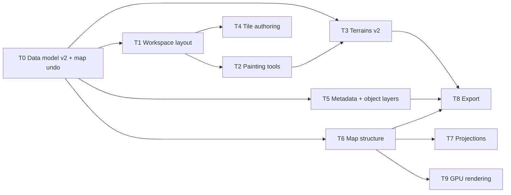

# Pixet — Advanced Tiles Workspace: Implementation Plan

> Hand-off document for an implementing agent. Read **§0 Context & Rules** fully before touching code.
> Work milestone by milestone (T0 → T9). Each milestone must end green (all checks in §0.5) and be committed separately on `main`.

---

## 0. Context & Rules

### 0.1 Project
- **Pixet** (`e:\desarrollo\pixet`): pixel-art editor for game devs.
- Stack: **Tauri v2** + Rust workspace (`crates/pixet-core`, `crates/pixet-cli`, `src-tauri`) + **Vite + React 18 + TypeScript (strict) + Zustand + lucide-react**.
- Remote: `origin` → https://github.com/jalatodeguerra/pixet (commit email is configured repo-locally; do not change it).

### 0.2 Existing tile code (read these first)
| File | What it contains today |
|---|---|
| `src/engine/tiles/TilemapEngine.ts` | `Tileset` (single, `tiles: PixelBuffer[]`, index 0 = empty, `add/duplicate/deleteTile`, `resizeTiles` 4..64, `seedStarterTiles`), `TilemapData` (`cols`, `rows`, `grid: Uint16Array`, `get/setCell`, `replaceTileId` (shifts ids on delete), `resize`, `clone`), `renderTilemapToBuffer`, `compositeSourceOnto`, `blendChannel`. |
| `src/engine/tiles/autoTile.ts` | `AutoTileRuleset { mode: "4bit" \| "blob47", fallbackTileId, maskToTile: Map }`, `computeAutoTileBitmask`, `resolveAutoTileId` (blob → 4-bit fallback), `paintAutoTileCell` (recomputes 3×3 neighborhood), `generate16TileAutoTileSet`. **Only one ruleset; it is not persisted; there is no blob47 generator.** |
| `src/engine/tiles/isometric.ts` | `isoToScreen` / `screenToIso` (2:1 diamond), `plotIsoLine`, `plotIsoDiamond`, `plotIsoBox`, `buildIsoGridSvgPath`, `renderIsometricTilemapToBuffer` (row→col painter order, iso tile height = `tileW/2`). |
| `src/engine/document/PixelEngine.ts` | `pixelEngine.tileset`, `tilemaps: Map<celKey, TilemapData>`, `autoTileRuleset`, `tileProjection`, `getTilemap/getOrCreateTilemap` (grid sized from canvas / tile size), `setTilemapCell`, `editTilePixelAtCanvasCoord` (live-edit all instances), `deleteTileFromTileset`, `paintAutoTileAtCell`, `resizeTileset`; tilemap layers composited in two places (~L649 and ~L765). |
| `src/components/TilesetPanel.tsx` | Right-sidebar panel: tile size select (8/16/32), new tilemap layer, add/dup/delete tile, swatch grid, Auto-Tile toggle + mode select + "Gen 16-Tile", Ortho / Iso 2:1 toggle. |
| `src/components/Viewport.tsx` | `tileStamp` tool handling (~L1074, ~L1562, ~L1958), `paintTilemapBrushPoint` (~L665), tile grid overlay (~L2188). **~2400 lines with repeated fragments — always include surrounding function context when editing.** |
| `src/components/ToolRail.tsx` | Single `tile-group` with `tileStamp (T)`. |
| `src/store/editorStore.ts` | `WorkspaceMode = "draw" \| "tiles" \| "rig" \| "data"`, `showTileGrid`, `activeTileId`, `tileWidth/Height`, `tilesetVersion` + `bumpTilesetVersion()`, `autoTileEnabled`, `autoTileMode`, `tileProjection`, `showIsoGrid`, `addTilemapLayer()`. |
| `src/engine/history/TileHistory.ts` | Pixel undo stack (64×64 *pixel* chunks — "tile" here means history chunk, unrelated to tilesets). **Tilemap cell stamps are not undoable today.** |
| `src/engine/io/projectBridge.ts` | `.pixet` save/load: tilemap grids per frame (`RustTilemapGrid { cols, rows, cells }`), tileset meta + base64 tile pixels, `tile_projection`. Export formats `godot_tileset`, `tiled`. |
| `crates/pixet-core/src/document.rs` | `TilesetMeta`, `TilemapGrid { cells: Vec<u16> }`, `TileProjection { Orthogonal, Isometric }`. |
| `crates/pixet-core/src/export.rs` | `build_tileset_atlas` (with extrude), `generate_godot_tileset`, `generate_tiled_tileset_json` (tileset only, no maps). |
| `tests/engine.test.ts` | Existing tile tests: Tileset/TilemapData ops, live-linked editing + tile deletion, autotile bitmasks. |

### 0.3 Current gaps this plan closes
1. No undo for map edits; no flip/rotate per cell; tile delete renumbers every map.
2. One tileset, one autotile ruleset (not saved), no blob47 tiles, no terrain editor.
3. Only a single-cell stamp tool — no rect/fill/line/picker/selection/multi-tile brushes/random.
4. No tile metadata (collision, properties, animation), no object layers.
5. Map size is tied to canvas size; no parallax/layer offsets; no world/rooms view.
6. Iso is basic (no elevation, no hex/staggered), CPU rendering only.
7. Exports emit tilesets but not maps, terrains, physics or custom data.

### 0.4 Hard rules
1. **UI style (user-enforced):** flat neutral dark-gray (`#141414`, `#1a1a1a`, `#202020`, `#272727`, `#303030`, accent `#4c8bf5`). **0px border-radius, no `box-shadow`, no `text-shadow`, no `backdrop-filter`, no decorative gradients, no glows.** Reuse classes in `src/styles/layout.css` (`panel-section`, `panel-header`, `panel-collapse-btn`, `panel-body`, `mini-btn`, `icon-action-btn`, `toggle-chip`, `tileset-*`, `palette-select`). New classes use the `tiles-` prefix.
2. **Engine purity:** everything under `src/engine/**` is React-free and imports relatives **with explicit `.ts` extensions** (required by `node --test`).
3. **TypeScript:** `strict`, `noUnusedLocals`, `noUnusedParameters`. No `any`.
4. **Backward compatibility:** old `.pixet` files (u16 cells, no tile metadata) must load unchanged. New data is versioned (`tiles_version: 2`) with a migration path.
5. **Pixel-art correctness:** tiles render nearest-neighbor only; flips/rotations are exact pixel permutations (90° steps only for non-square tiles: disallow 90°/270° unless `tileWidth === tileHeight`).
6. Do not grow `Viewport.tsx`: new tile pointer logic lives in `src/components/tiles/useTilePointer.ts` (T1).

### 0.5 Definition of done (run after every milestone)
```powershell
rg -n "box-shadow|text-shadow|backdrop-filter|border-radius:\s*[1-9]" src/styles/   # must print nothing
node --test tests/engine.test.ts                                                     # all pass
pnpm run build                                                                        # tsc && vite build, 0 errors
cargo test --workspace                                                                # all pass
git add -A; git commit -m "feat(tiles): <milestone summary>"
```
Add **new unit tests** for every new engine function (put tile tests in `tests/tiles.test.ts` if `engine.test.ts` gets too large, and add it to the test command).

---

## Feature Overview (what "advanced" means here)

| Area | Features |
|---|---|
| **Painting tools** | Stamp, multi-tile brush, rectangle fill, bucket fill (contiguous / global replace), line, eraser, eyedropper (Alt), cell selection with move / copy / paste / delete, random & weighted brush, pattern fill, flip/rotate brush (X / Y / Z keys). |
| **Terrains / autotiling** | Persistent multiple rulesets, visual ruleset editor (click 3×3 peering bits), templates (16-tile, blob-47, Godot 3×3 minimal, RPG Maker A2, Wang corner/edge), auto-generated blob-47 tiles from 5 source pieces, multi-terrain transitions, rule-based auto-mapping. |
| **Tile authoring** | Isolated tile editor with 3×3 wrap preview (seamless check), import & slice tileset images (margin/spacing), slice canvas into tiles with dedupe (incl. flipped duplicates), animated tiles, alternate/variant tiles, drag-reorder without breaking maps, unused/duplicate tile finder. |
| **Metadata** | Collision shapes (full, half, slopes, polygon), one-way, typed custom properties per tile, per-tile tags; object layers (points, rects, polygons, entities with properties); collision overlay. |
| **Map structure** | Map size independent of canvas, chunked infinite maps, multiple tilesets per map, layer offset/parallax/tint, minimap, world view with rooms/levels (LDtk-like). |
| **Projections** | Improved iso 2:1 with elevation + correct depth sort, staggered iso, hex (pointy/flat), pixel-accurate iso hit-testing. |
| **Export** | Tiled `.tmj`/`.tsj` (maps + objects + properties + animations + flips), Godot 4 `TileSet` with physics/terrains/custom data + `TileMapLayer` scene, LDtk-style JSON, generic runtime JSON, CLI `pixet export-map`. |
| **Performance** | WebGL2 instanced tilemap rendering, chunk dirty-tracking, cached thumbnails. |



---

## T0 — Tile Data Model v2, Map Undo & Persistence

**Goal:** a stable data model every later milestone plugs into.

### Cell encoding (`src/engine/tiles/cell.ts`)
- `TilemapData.grid` becomes `Uint32Array`. Encoding (Tiled-compatible flag bits):
  ```ts
  const FLIP_H = 0x80000000, FLIP_V = 0x40000000, FLIP_D = 0x20000000; // D = anti-diagonal (rotation)
  const TILESET_SHIFT = 20; // bits 20..28 → tileset index (0..511)
  const LOCAL_MASK = 0x000fffff; // local tile index (0 = empty)
  export function packCell(tilesetIndex, localId, flags): number;
  export function unpackCell(cell): { tilesetIndex; localId; flipH; flipV; flipD };
  export function rotateCellCW(cell) / flipCellH(cell) / flipCellV(cell);
  ```
- Rendering applies flags via `blitTileTransformed(dst, tileBuf, x, y, flags, opacity, blend)` (exact pixel permutation, no resampling).

### Tilesets (`src/engine/tiles/Tileset.ts` — split out of `TilemapEngine.ts`, re-export for compatibility)
```ts
interface TileMeta {
  uid: string;                 // stable id, survives reorder/delete
  name?: string;
  tags?: string[];
  properties?: Record<string, TileProperty>; // T5
  collision?: CollisionShape[];              // T5
  animation?: { frames: { localId: number; durationMs: number }[] }; // T4
  probability?: number;        // random/variant weight, default 1
}
type TileProperty = { type: "bool"; value: boolean } | { type: "int" | "float"; value: number }
  | { type: "string" | "color" | "file"; value: string } | { type: "enum"; value: string; options: string[] };
class Tileset { id; name; tileWidth; tileHeight; margin; spacing; tiles: PixelBuffer[]; meta: TileMeta[]; }
class TilesetRegistry { tilesets: Tileset[]; get(index); add(ts); remove(index); resolve(cell): { tileset; buf; meta } | null; }
```
- `pixelEngine.tileset` stays as a getter for `registry.tilesets[0]` so old callers keep working.
- **Delete without renumbering surprises:** `deleteTile` still compacts, but returns a remap table applied to every tilemap, ruleset and animation (`remapTileIds(map: Map<old,new>)`). Add `reorderTiles(newOrder)` using the same remap.

### Map undo (`src/engine/tiles/TilemapHistory.ts`)
- Cell-delta transactions: `begin(label, layerId, frame)`, `record(col, row, before, after)` (first `before` wins), `commit()`, `cancel()`.
- Tileset-structure ops (add/delete/reorder/resize/import) push a snapshot entry (`toSnapshot()` JSON of the registry + affected maps, cap 50).
- Unify with pixel history: introduce a tiny `UndoStack` coordinator in `historyActions.ts` that holds entries `{ kind: "pixels" | "cells" | "tileset", ... }` in a single chronological order so Ctrl+Z always undoes the latest action regardless of type.

### Persistence
- Rust (`crates/pixet-core/src/document.rs`): `TilemapGrid.cells` → `Vec<u32>` with `#[serde(deserialize_with = ...)]` accepting old u16 arrays (they are numerically valid u32). Add `#[serde(default)] pub tiles_ext: Option<serde_json::Value>` on the document for registry meta, extra tilesets, rulesets (opaque to Rust, like `rig`). Add `tiles_version: u32` default 1.
- `projectBridge.ts`: write `tiles_version: 2`, extra tilesets' pixels in `tiles_ext.tilesets[i].pixels` (base64), rulesets, metadata. On load with version 1: wrap everything into tileset 0, all flags 0.
- Update `aseprite.rs` / `export.rs` / `pixet-cli` call sites for the u32 change.

**Tests:** pack/unpack round-trip; rotate ×4 = identity; flip-transformed blit matches expected pixels; delete/reorder remap updates maps & rulesets; cell undo/redo; mixed pixel+cell undo order; v1 project loads; Rust round-trip of u16 legacy JSON.

---

## T1 — Focused Tiles Workspace Layout

**Goal:** entering Tiles mode turns Pixet into a dedicated level editor.

1. **Sub-modes** — store `tilesMode: "map" | "tile"` (segmented toggle next to workspace tabs in `TopBar.tsx`):
   - *Map:* paint cells on tilemap layers.
   - *Tile:* edit the selected tile's pixels in isolation (T4) with draw tools.
   - Viewport cue: 2px flat top border (`#4c8bf5` map, `#22c55e` tile).
2. **Tile tool rail** — `ToolRail.tsx` shows a tile-specific set when `workspaceMode === "tiles"` and `tilesMode === "map"`:
   `Stamp (T)`, `Brush (B)`, `Rect (R)`, `Fill (G)`, `Line (L)`, `Eraser (E)`, `Picker (I)`, `Select (M)`, `Random (N)`, `Terrain (A)`, `Object (O)` (T5). New store union `TileTool`.
3. **Tiles sidebar** — split into `src/components/tiles/`:
   `TilesetBrowserPanel.tsx` (tabs per tileset, zoomable grid, rectangular multi-select, drag-reorder), `TilePropertiesPanel.tsx`, `TerrainPanel.tsx` (T3), `TileLayersPanel.tsx` (map layers with offset/parallax), `MapPropertiesPanel.tsx` (map size, grid, projection). When `workspaceMode === "tiles"`, hide Color & Palette in map sub-mode.
4. **Large tileset browser** — option to dock the tileset browser at the bottom (replacing the timeline height) for big tilesets; zoom 1×–4×, scrollable, keyboard arrows to move selection.
5. **Viewport refactor** — move tile pointer logic (`tileStamp`, `paintTilemapBrushPoint`, grid overlay) into `src/components/tiles/useTilePointer.ts` + `src/components/tiles/TileOverlay.tsx` (SVG: hover cell, brush ghost preview at 50% opacity, selection marquee, collision overlay later). Viewport delegates when `workspaceMode === "tiles"` or active layer is a tilemap.
6. **Status bar** — show `col,row`, cell tile id, tileset name, flags (e.g. `H V R`).

**Tests:** store tool-switch reducers; overlay geometry helpers (`cellRectToScreen`) are pure and tested.

---

## T2 — Map Painting Tools

**Goal:** Tiled/LDtk-level painting. All algorithms are pure functions in `src/engine/tiles/mapTools.ts` returning `CellChange[]` (`{ col, row, before, after }`) so undo (T0) is automatic.

```ts
interface TileBrush { cols: number; rows: number; cells: Uint32Array /* 0 = transparent */ }
```
1. **Multi-tile brush** — rectangle-select in the tileset browser or Select tool on the map → brush. Brush transforms: `X` flip H, `Y` flip V, `Z` rotate CW (rotates layout *and* each cell's flags).
2. **Stamp/Brush** — Bresenham between pointer samples so fast drags don't skip cells; brush anchored at top-left or center (option).
3. **Rect fill** — drag rectangle; fill with brush tiled as a pattern (`brush.cells[(c % cols) + (r % rows) * cols]`).
4. **Bucket fill** — 4-connected flood on equal cell value; options: contiguous / replace-all-on-layer; pattern fill with brush; cap at 1M cells.
5. **Line** — cell-space Bresenham; Shift snaps to 45°.
6. **Eraser** — brush-shaped erase (sizes 1–8).
7. **Picker** — Alt+click picks the cell (incl. flags) as a 1×1 brush; Alt+drag picks a region as brush (across visible layers optional).
8. **Select** — marquee/additive (Shift)/subtractive (Alt); Ctrl+C/X/V; drag to move as a floating cell selection; Delete clears; selection works across all frames optionally.
9. **Random brush** — choose N tiles in the browser; each painted cell picks one weighted by `TileMeta.probability`; seeded RNG (`mulberry32`) so preview == result.
10. **Ghost preview** — overlay shows the brush with real tile pixels under the cursor before commit.

**Tests:** each tool on small maps (expected `CellChange[]`), pattern alignment, rotate brush layout, flood fill boundaries, random brush determinism with fixed seed.

---

## T3 — Terrains & Autotiling v2

**Goal:** powerful, persistent, editable terrains.

1. **Data model** (`src/engine/tiles/terrain.ts`):
   ```ts
   type TerrainMode = "edges4" | "blob47" | "corners" | "edgesCorners"; // corners = Wang 2-corner
   interface Terrain { id; name; color: string }
   interface TerrainSet { id; name; mode: TerrainMode; tilesetIndex; terrains: Terrain[];
     // per tile: terrain id at each peering bit (8 bits: N NE E SE S SW W NW; corners use only diagonals)
     peering: Record<number /*localId*/, (string | null)[]>; }
   ```
   Keep the existing `AutoTileRuleset` as an adapter (`rulesetFromTerrainSet`) so current code paths still work during migration.
2. **Solver** — `resolveTerrainTile(set, desiredPeering)` picks the tile with max matching bits (exact match first, then best score, random among ties via `probability`). Painting with Terrain tool marks the cell's terrain then re-solves the 3×3 (or 5×5 for corner modes) neighborhood. Supports **multiple terrains with transitions** (e.g. water↔sand↔grass) as long as transition tiles exist.
3. **Visual editor** (`TerrainPanel.tsx`) — select terrain, then click peering-bit zones drawn over each tile in the browser (flat colored squares in terrain color, no rounded shapes). Shows which of the 47/16 combinations are missing.
4. **Templates & importers** — one-click layouts that auto-assign peering bits when a tileset image follows a known layout: 16-tile 4×4, blob-47 (7×7 / 12×4 Godot minimal), RPG Maker A2 autotile (2×3 mini-tile layout), Wang 2-corner 4×4.
5. **Blob generator** — `generateBlob47FromPieces(pieces: { center, outerCorner, innerCorner, edgeH, edgeV })`: compose all 47 tiles from quarter-tile sub-pieces (RPG-Maker style), writes tiles + peering. Also add `generateBlob47AutoTileSet` analogous to the existing 16-tile demo generator.
6. **Rule-based auto-mapping** (`src/engine/tiles/automap.ts`) — rules `{ match: cell patterns (tile | terrain | empty | any | not), output: brush, probability, layerTarget }`; "Run Rules" applies to the layer or selection (one undo entry). Use cases: auto-place shadows under walls, decorate grass randomly, add edge tiles on another layer.

**Tests:** solver exact & best-match; blob47 generator produces 47 unique masks; neighborhood update after erase; multi-terrain transition pick; automap pattern matching with `not`/`any`.

---

## T4 — Tile Authoring

1. **Tile edit sub-mode** — viewport shows the selected tile at large zoom, with a **3×3 wrap preview** (tile repeated around itself, toggle) to check seamlessness; all draw tools work, writes go through pixel history via a proxy cel. Option "preview on map": edits update the map live (already supported by live-linking).
2. **Import tileset image** — modal: pick PNG, tile size, margin, spacing, skip empty tiles, dedupe; creates a new tileset in the registry (`sliceImageToTiles` pure function).
3. **Slice canvas / layer to tiles** — convert a raster layer into tileset + tilemap layer; dedupe exact matches and optionally flipped/rotated matches (store flags in cells). Report "N unique tiles from M cells".
4. **Animated tiles** — frames + durations in `TilePropertiesPanel`; viewport plays them when "Animate tiles" is on (driven by the existing playback clock); exports include animation data.
5. **Variants** — mark tiles as alternates of a base tile (via shared tag `variant:<baseUid>` + `probability`); Random brush and terrain solver use them.
6. **Housekeeping** — find unused tiles, find duplicates (merge → remap maps), sort by usage, drag-reorder (uses T0 remap), rename, tag filter search in the browser.
7. **Tile size options** — allow non-square tiles (8–64, e.g. 16×24) and custom sizes in the size control.

**Tests:** slicing with margin/spacing; dedupe incl. flips; animation frame at time `t`; merge duplicates remap.

---

## T5 — Tile Metadata & Object Layers

1. **Collision** (`src/engine/tiles/collision.ts`):
   ```ts
   type CollisionShape = { kind: "rect"; x; y; w; h } | { kind: "polygon"; points: [number, number][] }
     | { kind: "preset"; preset: "full" | "halfTop" | "halfBottom" | "slopeL" | "slopeR" | "slopeL2a" | "slopeL2b" | "slopeR2a" | "slopeR2b" };
   interface TileMeta { /* + */ collision?: CollisionShape[]; oneWay?: boolean; collisionLayer?: number }
   ```
   Preset picker + small polygon editor (pixel-snapped vertices) in the tile edit sub-mode. Collision overlay toggle in map mode (flat semi-transparent fill `rgba(76,139,245,0.35)`, outline 1px).
   - Flipped/rotated cells transform shapes accordingly (`transformShape(shape, flags, w, h)`).
2. **Custom properties** — typed property editor (bool/int/float/string/color/enum/file) on tiles, tilesets, tilemap layers and maps. Property *schemas* per tileset so every tile shares field definitions.
3. **Object layers** — new `LayerKind "object"` (Rust enum + bridge). Objects: `{ id, name, type, x, y, w?, h?, points?, tileCell?, properties, rotation? }`. Tool `Object (O)`: place point/rect/polygon/tile-object, select/move/resize, snap to grid or pixel. Entity "types" defined once with default properties & color (LDtk-like entity definitions).
4. **Integration with Data workspace** — if `GameDataEngine` defines types, offer them as entity/property enums (read-only link, no hard coupling).

**Tests:** shape transform with flags; property schema validation; object hit-testing; object layer persistence round-trip.

---

## T6 — Map Structure

1. **Map size decoupled from canvas** — tilemap layers get `mapCols/mapRows` in a `TileMapDocument` (per layer or per document setting); canvas viewport shows the map bounds; "Fit canvas to map" command. Keep current behaviour (grid derived from canvas) as default for old files.
2. **Chunked / infinite maps** — `ChunkedTilemap` (16×16 chunks in a `Map<"cx,cy", Uint32Array>`) implementing the same interface as `TilemapData` (`getCell/setCell/bounds()`); all T2 tools target the interface. Option per layer: fixed or infinite.
3. **Layer properties** — offset (px), parallax factor (x/y, preview only), tint, opacity, visibility, lock, per-layer tileset restriction.
4. **Minimap** — small canvas in the sidebar rendered from a cached low-res composite, click to navigate.
5. **World view (multi-room)** — `worldMode`: `WorldData` (`rooms: Array<{ id, name, worldX, worldY, cols, rows, layerIds: string[] }>` stored in `tiles_ext.world`). Create, reposition, and resize rooms on the world canvas; show dimmed neighbor room previews at room boundaries for seamless authoring; double-click a room to open/focus it.

**Tests:** chunked map get/set across chunk boundaries and negative coords; bounds; tools behave identically on fixed vs chunked maps; room bounds & neighbor queries.

---

## T7 — Projections

1. **Projection enum** — `"orthogonal" | "isometric" | "isoStaggered" | "hexPointy" | "hexFlat"` (Rust `TileProjection` gains variants with serde defaults). `src/engine/tiles/projection.ts` exposes a `Projection` interface: `cellToScreen`, `screenToCell`, `cellPolygon`, `drawOrder(cells)`, `neighbors(cell)` (hex → 6 neighbors; terrains in hex use 6-bit masks).
2. **Iso improvements** — configurable iso tile height (default `w/2`, not hard-coded), **elevation** per layer (z offset in px) with correct depth sort across layers by `(row + col, layerZ)`; pixel-accurate hit-testing using tile alpha masks for tall tiles; iso brush preview as diamond.
3. **Iso helpers in tile edit mode** — diamond guide overlay, existing `plotIsoLine/plotIsoBox` exposed as tools ("Iso Line", "Iso Box") so artists can draw iso tiles quickly.
4. **Hex (core)** — `hexPointy` (odd-r) and `hexFlat` (odd-q) offset coordinates, grid overlay paths, hit-testing, and painting tools adapted through `neighbors()`. Align coordinate conventions with Godot 4's `TileSet.TILE_SHAPE_HEXAGON` (`tile_shape = 3`) and `tile_offset_axis` (horizontal for pointy-top odd-r, vertical for flat-top odd-q).

**Tests:** cell↔screen round-trip for every projection; hex neighbors; iso depth order with elevation.

---

## T8 — Export & Interop

Prefer implementing exporters in **Rust** (`crates/pixet-core/src/export_tiles/`) so the CLI can use them; the TS side only gathers the project (already transferred via `projectBridge`).

1. **Godot 4 (primary)** —
   - `TileSet` `.tres` with atlas sources, physics layers + one-way flags from collision, terrain sets (map Pixet modes → Godot `TERRAIN_MODE_MATCH_CORNERS_AND_SIDES` / `MATCH_CORNERS` / `MATCH_SIDES`), custom data layers from property schemas, tile animations (`animation_frames_count`, durations), and projection settings (`tile_shape` / `tile_offset_axis` for ortho, iso, staggered, and hex).
   - Per-map/room `.tscn` scene with `TileMapLayer` nodes (`tile_map_data` packed bytes, alternative tiles for flips/rotations via `TileSetAtlasSource.TRANSFORM_FLIP_H/V/TRANSPOSE`, layer offset/z-index/modulate) plus object layer export (`Node2D`/`Marker2D` with metadata or `Area2D` + `CollisionShape2D`).
   - Multi-room **World `.tscn`** that instances each room scene at its `(worldX, worldY)` position.
2. **Tiled (secondary)** — `.tmj` map (orthogonal/isometric/staggered/hexagonal, layers, chunked infinite data, flip flags in GIDs with per-tileset `firstgid`, object groups, properties, parallax/offset) + `.tsj` tilesets (image atlas, tile properties, collision as `objectgroup`, animations, Wang sets from terrains). Optional `.tmx` (XML).
3. **LDtk-style / generic JSON (secondary)** — `pixet-map-v1` runtime JSON: tilesets, layers (cells as flat arrays), objects, properties, collision — documented in `docs/formats/pixet-map-v1.md`.
4. **Images** — export map as PNG (per layer or flattened), collision mask PNG, tileset atlas with extrusion (existing `build_tileset_atlas`).
5. **Import (stretch)** — import Tiled `.tmj` maps + tilesets.
6. **UI** — extend `ExportModal.tsx` with a "Map" section (format, which layers, atlas options, output dir). Tauri: reuse existing write commands or add `write_files(out_dir, files)` in `src-tauri/src/lib.rs`.
7. **CLI** — `pixet export-map <file.pixet> --format godot|tiled|json --out <dir>` in `crates/pixet-cli`.

**Tests (Rust):** Godot terrain mode & hex/iso projection mapping, `TileMapLayer` packed bytes + world `.tscn` instancing; GID encoding with flags and multiple tilesets; exported JSON validates expected keys; golden-file tests for a tiny 3×3 map in each format.

---

## T9 — Performance & GPU Rendering

1. **WebGL2 tilemap path** in `src/engine/renderer/WebGL2Renderer.ts`: upload each tileset as an atlas texture (rebuild on `tilesetVersion` change), each tilemap chunk as an `R32UI` texture; fragment shader looks up cell → tile → texel with flip flags. Fallback to CPU path for export and when WebGL2 unavailable.
2. **Dirty tracking** — chunk-level dirty flags; only re-upload modified chunks.
3. **Caching** — tile thumbnails rendered once into a shared atlas canvas instead of one `<canvas>` per swatch (current `TileThumbnail`), layer thumbnails cached per `(layer, frame, tilesetVersion, mapVersion)`.
4. **Budget** — 256×256-cell map with 4 layers pans at 60 fps; log-only benchmark test.

**Tests:** CPU vs GPU output parity on a small map (readPixels in a headless-safe path, skip if no WebGL), dirty chunk bookkeeping.

---

## Suggested Order & Sizing
| Milestone | Depends on | Size |
|---|---|---|
| T0 Data model v2 + map undo + persistence | — | L |
| T1 Focused workspace layout | T0 | L |
| T2 Painting tools | T1 | L |
| T3 Terrains & autotiling v2 | T0, T2 | XL |
| T4 Tile authoring | T1 | M |
| T5 Metadata & object layers | T0 | L |
| T6 Map structure (size, chunks, world) | T0 | L |
| T7 Projections (iso+, hex) | T6 | M |
| T8 Export & interop | T3, T5, T6 | L |
| T9 GPU rendering | T6 | M |

**Quick wins if time is short:** map undo (T0), flip/rotate cells (T0), rect/fill/picker/multi-tile brush (T2), persistent rulesets + blob-47 generator (T3), Godot 4 `TileMapLayer` export (T8).

## Guidance for the implementing agent
- Before each milestone, re-read the files you will touch; line numbers here are not guaranteed.
- Prefer small pure functions in `src/engine/tiles/*` with tests, then thin React wiring.
- After every tileset/map mutation from UI: record history (T0), `bumpTilesetVersion()` (tileset changes) and `pixelEngine.emitChange()`.
- Never break: `.pixet` loading of older files, existing tile tests, Draw/Rig/Data workspaces.
- If a design decision isn't covered here, choose the simplest option consistent with §0.4 and note it in the commit message.

## Confirmed scope decisions
1. **Primary export target:** **Godot 4** (`TileSet` `.tres`, per-room `TileMapLayer` `.tscn`, and multi-room World `.tscn`); Tiled and generic JSON remain secondary formats.
2. **Multi-room world view:** In core scope (T6.5 `WorldData` + world canvas + Godot World `.tscn`).
3. **Hex grids:** In core scope (T7.4 `hexPointy` odd-r / `hexFlat` odd-q, aligned with Godot 4's `TILE_SHAPE_HEXAGON`).
