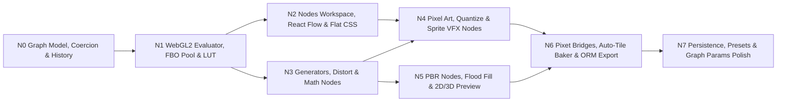

# Pixet — Node Material & Compositor Workspace (v2 Implementation Plan)

> **Status:** Reviewed & Locked Plan (Post-Carbon Architectural Review).  
> **Hand-off Note:** Read **§0 Context, Hard Rules & Codebase Guardrails** before touching code. Work milestone by milestone (`N0` → `N7`); every milestone must pass all checks in **§0.4** before committing.

---

## 0. Context, Decisions & Codebase Guardrails

### 0.1 Project Context & Existing Reusable Pieces
- **Pixet** (`e:\desarrollo\pixet`) is a pixel-art & game-asset authoring suite built on **Tauri v2** + Rust workspace (`crates/pixet-core`, `crates/pixet-cli`, `src-tauri`) + **Vite + React 18 + TypeScript (strict) + Zustand + `lucide-react` + WebGL2**.
- Existing workspaces in `src/components/TopBar.tsx`: `Draw`, `Tiles`, `Rig`, `3D Studio`, and `Data`.
- Existing engine modules to reuse or bridge directly:
  - `src/engine/document/PixelBuffer.ts`, `PixelEngine.ts` & `blendModes.ts`
  - `src/engine/gamedev/pbrMaps.ts` (2-pass Chamfer bevel/pillow height, opaque-only blur, Sobel/Scharr normal, depth map)
  - `src/engine/gamedev/shaderPreview.ts` (`LayerMapRole = "albedo" | "normal" | "height" | "depth" | "emission"`, 2D Blinn-Phong + height raymarch lighting)
  - `src/engine/tiles/autoTile.ts` & `terrain.ts` (4-bit 16-tile & 8-bit 47-tile blob bitmasks and rulesets)
  - `src/engine/tools/rotsprite.ts`, `dither.ts`, `paletteOps.ts`, `src/utils/color.ts`
  - `src/engine/renderer/WebGL2Renderer.ts`
  - `src/engine/history/UndoCoordinator.ts` & `src/engine/document/historyActions.ts`
  - `src/components/DockablePanelSection.tsx`, `src/engine/ui/panelLayout.ts`, `src/components/CommandPalette.tsx`
  - `crates/pixet-core/src/document.rs` & `src/engine/io/projectBridge.ts`

### 0.2 Architectural Decisions (Locked)
1. **50/50 Hybrid Focus**: Equally serves **procedural tileable PBR material authoring** (Material Maker / Substance Designer style: noise, Voronoi, SDFs, bricks, flood-fill cell metrics, slope blur, directional warp, height-blend, PBR maps) and **pixel-art compositing & sprite VFX** (Pixel Composer style: outlines, RotSprite/Scale2x cleanup, morphology, drop shadows/rim light, OKLab palette quantization, Bayer dithering, glow, chromatic aberration, sprite/tile processing).
2. **WebGL2 Per-Node FBO Engine + Single Shared Offscreen Context**:
   - One offscreen WebGL2 context (`WebGL2NodeEvaluator`) owns **all** intermediate FBOs, node thumbnails, 2D preview passes, **and** the 3D PBR preview pass.
   - *Why single-context for 3D too:* WebGL2 textures cannot be shared across distinct `WebGL2RenderingContext` instances. Running the 3D PBR mesh pass inside `WebGL2NodeEvaluator` binds cached PBR textures directly with zero `gl.readPixels` stalls and blits to visible `<canvas>` elements via `CanvasRenderingContext2D.drawImage`, avoiding browser 8–16 WebGL context limits.
3. **Swappable UI Boundary (`@xyflow/react` in Phase 1)**:
   - React Flow v12 sits strictly behind `src/components/nodes/ReactFlowCanvas.tsx` and `PixetFlowNode.tsx`.
   - It never touches WebGL, FBOs, or shader compilation, so it can be replaced in Phase 2+ by a custom Pixet Canvas2D/WebGL2 graph editor without touching `src/engine/nodes/**`.
4. **Ref-Counted + LRU FBO Pool & Channel-Matched Precision**:
   - Single-channel `gray` sockets allocate `R16F` (2 bytes/px — **4× less VRAM** than `RGBA16F`), color/normal sockets allocate `RGBA16F` (8 bytes/px), and strictly 8-bit pixel outputs (`Palette Quantize`, `Outline`) can use `RGBA8` (4 bytes/px).
   - Separate persistent `64×64 RGBA8` thumbnail textures (16 KB/node) allow intermediate full-res FBOs to be recycled into a size/format-keyed FBO pool once downstream consumers finish when total VRAM exceeds a configurable budget (default **128 MB**), while keeping upstream generator outputs warm in LRU order for 60fps downstream slider scrubbing.
5. **Graceful `RGBA16F` Fallback (`RG8` 16-bit Height Packing)**:
   - In WebGL2 core, `R16F`/`RGBA16F` (`HALF_FLOAT`) textures are natively linear-filterable, and `EXT_color_buffer_float` (or `EXT_color_buffer_half_float`) enables rendering to them.
   - If float color buffers are unavailable on a restricted WebView/GPU, `gray` height/scalar buffers automatically pack 16-bit fixed-point values into `RG8` (`R = hi8`, `G = lo8` inside `RGBA8`, 65,536 steps) via shared GLSL helpers `packScalar()` / `unpackScalar()`, eliminating 8-bit stair-stepping artifacts on `Height → Normal` and `Slope Blur`.
6. **Persistence via Opaque `nodes_ext` + Deduped Asset Table**:
   - Follow the established `crates/pixet-core/src/document.rs` pattern (`tiles_ext`, `draw_ext`, `rig`, `game_data`) by adding `#[serde(default, skip_serializing_if = "Option::is_none")] pub nodes_ext: Option<serde_json::Value>` rather than duplicating fast-evolving TypeScript node/param schemas in Rust, plus an optional lightweight CLI/metadata summary helper.
   - External images loaded into `Image Input` nodes are stored once in a content-addressed `assets: Record<assetId, { width, height, pngBase64 }>` table inside `nodes_ext` (and embedded in standalone `.pixet-graph.json` exports) so graphs never break across machines or duplicate megabytes per node copy.
7. **Animation & Subgraph Schema Readiness from Day 1**:
   - Every GLSL pass binds `u_time`, `u_frame`, and `u_progress` (`0..1` seamless loop) from day 1.
   - `NodeGraph` v1 reserves `exposedParams`, `subgraphInputs`, and `subgraphOutputs` from day 1 — powering a **Graph Parameters** quick-tweak panel in Phase 1 and enabling zero-migration Subgraphs in Phase 2.

### 0.3 Pixet Hard Rules & Keyboard Guardrails
1. **Flat Dark-Gray UI (Zero Exceptions)**:
   - Palette: `#141414`, `#1a1a1a`, `#202020`, `#272727`, `#303030`, borders `#2b2b2b` / `#3d3d3d`, accent `#4c8bf5` (`src/styles/theme.css`).
   - **0px `border-radius` (even on node cards, minimap, controls, and square socket handles), no `box-shadow`, no `text-shadow`, no `backdrop-filter`, no decorative gradients, no selection glows.**
   - All styles live in `src/styles/nodes.css` (`nodes-` prefix) with explicit `.react-flow__*` overrides stripping React Flow's default rounded corners, box-shadows, and handle circles.
2. **Engine Purity & TS Strictness**:
   - Everything under `src/engine/nodes/**` is React-free, DOM-independent where testable in Node (pure graph/history/CPU-bridge/serialization modules), and uses explicit `.ts` relative imports for `node --test`.
   - `strict: true`, `noUnusedLocals: true`, `noUnusedParameters: true`, zero `any`.
3. **`App.tsx` Keyboard Isolation (Preventing Global Shortcut Collisions)**:
   - `src/App.tsx` currently intercepts `Tab` (toggle panels), `Ctrl+C/X/V`, `Ctrl+A`, `Ctrl+D` (`deselectAll`), `Delete`/`Backspace` (pixel selection delete), `Enter` (play), `X` (swap colors), `[`/`]`, and single-letter Draw tool keys (`B`, `E`, `G`, `M`, `V`, etc.) globally.
   - When `workspaceMode === "nodes"`, `App.tsx` **must branch early** (just like `rig` and `tiles/map`) to route:
     - `Shift+A` or `/` → Open `QuickAddMenu` at cursor (`Tab` remains global panel-collapse toggle; `Space`+drag pans canvas).
     - `Ctrl+C` / `Ctrl+X` / `Ctrl+V` / `Ctrl+D` → Copy / Cut / Paste / Duplicate selected nodes & internal edges (remapping IDs + offsetting `+24, +24`).
     - `Ctrl+A` → Select all nodes; `Escape` → Clear node selection / close `QuickAddMenu`.
     - `Delete` / `Backspace` → Delete selected nodes & edges via `NodeHistory` (pass `deleteKeyCode={null}` to `<ReactFlow>` so React Flow never mutates edges outside `NodeHistory`).
     - `M` → Toggle **Bypass / Mute** on selected nodes; `P` → Pin/unpin selected node to Preview; `F` → Fit/frame selection (or whole graph if none selected); `Ctrl+G` → Wrap selected nodes in a Group Frame.

### 0.4 Definition of Done (Run After Every Milestone)
```powershell
rg -n "box-shadow|text-shadow|backdrop-filter|border-radius:\s*[1-9]" src/styles/   # must print nothing
node --test tests/engine.test.ts tests/nodes.test.ts                                 # all pass
pnpm run build                                                                        # tsc && vite build, 0 errors
cargo test --workspace                                                                # all pass
```

---

## 1. Pixet Ecosystem Bridges (What Makes This Uniquely Powerful)

Unlike standalone material tools (Material Maker) or standalone pixel compositors (Pixel Composer), Pixet's `Nodes` workspace sits live inside the same memory space as **Draw**, **Tiles**, **Rig**, **3D Studio**, and **Data**:

### 1.1 Live Inputs from Pixet
- **`Sprite Input`**: Pulls the active Draw document's composited frame, a specific layer, or a specific `(layerId, frameIndex)` cel as an `rgba` texture. Also supports **Map-Role Extraction** (`albedo`, `normal`, `height`, `depth`, `emission` from Pixet's `Layer.map_role`) to bring hand-painted PBR sprite layers straight into the graph. Automatically marks itself dirty on `pixelEngine` change events.
- **`Draw Selection Mask`**: Pulls `pixelEngine.selection` as a `gray` mask (`1.0` selected, `0.0` unselected), allowing artists to apply node stacks as non-destructive region filters on their active Draw sprite.
- **`Tileset Tile Input`**: Pulls any tile (`tilesetIndex`, `localId`) from `TilesetRegistry` to add procedural wear, moss, outlines, normals, or palette swaps.
- **`Palette Input` (GPU LUT)**: Streams the active document palette (or a custom ramp / imported `.hex`/`.gpl` preset) into a `256×1 RGBA8` GPU LUT texture so `Palette Quantize`, `Ordered Dither`, `Palette Remap`, and `Gradient Map` stay live-synced when the artist edits colors in Draw.
- **`Image Input`**: Imports external PNG/WebP reference or noise textures into the deduped `nodes_ext.assets` store.

### 1.2 Live & Batch Outputs Back to Pixet
- **Bake to Draw Layer (+ Live-Link Toggle)**: Rasterizes any `rgba`/`gray` output into a new or target Draw layer (optionally clipped to active selection). Enabling **Live Sync** auto-updates the target layer (debounced 120ms after parameter scrub ends) for live viewport feedback in Draw or **3D Studio** (`2.5D Extruded` / `Stack`).
- **Bake Material to Draw Map-Role Stack**: One click on `Material Output` creates or updates a grouped set of Draw layers tagged with Pixet's native `map_role`s (`albedo`, `normal`, `height`, `depth` from AO, `emission`) — immediately lighting up the sprite in Draw's 2D Lighting (`shaderPreview.ts`) and `3D Studio`!
- **Bake to Tileset Slot (+ Live-Link Toggle)**: Writes procedural tiles directly into a target `Tileset` tile ID and bumps `tilesetVersion`, immediately updating every painted instance across all `Tiles` maps.
- **Procedural Auto-Tile Set Baker (16-Tile 4-Bit & 47-Tile Blob)**: Pairs an `Auto-Tile Mask` generator node with `Material Height-Blend` (e.g., *Grass* over *Dirt* or *Stone Wall* over *Floor*). Clicking **Bake Auto-Tile Set** iterates through all 16 (4-bit) or 47 (8-bit blob) canonical bitmasks (`src/engine/tiles/autoTile.ts`), evaluates the graph per mask with organic SDF/height-blended borders, populates the `Tileset` slots, and registers the `AutoTileRuleset` automatically!
- **Game-Engine PBR & ORM Export**: Exports individual maps or complete engine-ready packs:
  - **Raw PBR Pack**: `_albedo.png`, `_normal.png` (configurable **OpenGL `+Y`** vs **DirectX `-Y`**), `_height.png`, `_roughness.png`, `_metallic.png`, `_ao.png`, `_emissive.png`.
  - **Channel-Packed ORM**: `_orm.png` (`R = AO`, `G = Roughness`, `B = Metallic`) + optional **Godot 4** `.tres` (`CanvasTexture` for 2D lit sprites or `StandardMaterial3D` for 3D meshes).

---

## 2. Architecture & Data Model

### 2.1 File Layout

```text
src/
  engine/
    nodes/                        # 100% React-free, explicit .ts imports
      types.ts                    # SocketType, ParamDef, NodeGraph, ExposedParam, AssetTable
      NodeRegistry.ts             # Declarative node catalog, coercion table, schema validation
      NodeGraph.ts                # Immutable/pure graph ops, Kahn topo sort, cycle check, copy/paste, bypass
      NodeHistory.ts              # Undo/redo stack + drag/scrub transaction coalescing
      FboPool.ts                  # Size/format FBO pool, consumer refcounts, 128 MB LRU eviction
      WebGL2NodeEvaluator.ts      # Shared WebGL2 context, KHR_parallel_shader_compile, dirty eval, 3D PBR pass
      PaletteLut.ts               # Pixet Palette / multi-stop ramps -> 256x1 RGBA8 GPU LUT + OKLab helpers
      blitBridge.ts               # Zero-readback 2D/3D/thumbnail drawImage blitter + export/bake readback
      pixetBridges.ts             # Sprite/Selection/Tileset inputs, Draw/MapRole/Tileset/AutoTile bakers, ORM/Godot export
      presets.ts                  # Built-in starter material & sprite VFX graph templates
      shaders/
        common.glsl.ts            # Fullscreen triangle VS, RG8 16-bit fallback pack/unpack, hash, OKLab, blend modes
        noise.glsl.ts             # Seamless periodic Perlin, Simplex, Worley/Voronoi F1/F2, FBM
        sdf.glsl.ts               # 2D shapes, rounded bevels, bricks/truchet/weave, auto-tile bitmask SDFs
        pbr.glsl.ts               # Sobel/Scharr normal, horizon AO, curvature, height-blend, Cook-Torrance 3D preview
      definitions/
        inputNodes.ts             # Sprite, Selection Mask, Tileset Tile, Palette, Solid Color, Image
        generatorNodes.ts         # Noise, Voronoi, Bricks, SDF, Gradient, Weave/Truchet, Splatter, Auto-Tile Mask
        filterWarpNodes.ts        # Directional Warp, Warp, Slope Blur, Blur/Sharpen, Transform/Tile, Make Tileable
        pixelVfxNodes.ts          # Blend, Pixelate, Pixel Clean (Scale2x/RotSprite), Quantize/Dither, Palette Remap,
                                  # Gradient Map, Outline, Morphology, Drop Shadow/Rim, Glow, Chromatic/CRT
        adjustMathNodes.ts        # Levels/Histogram Scan, HSV, Invert/Threshold, Math, RGBA Pack/Unpack, Flood Fill
        pbrOutputNodes.ts         # Height->Normal, Height->AO, Curvature, Sprite->PBR, Material Combine/Split/Blend,
                                  # Material Output, Bake to Draw, Bake to Tileset
  components/
    nodes/                        # Thin React UI layer
      NodesWorkspace.tsx          # Center canvas + top toolbar + right dockable sidebar
      ReactFlowCanvas.tsx         # Strict adapter: NodeGraph <-> @xyflow/react (swappable in Phase 2+)
      PixetFlowNode.tsx           # Flat 0px card: header, bypass/pin badges, square typed handles, 64x64 thumbnail
      QuickAddMenu.tsx            # Shift+A / wire-drop fuzzy node search palette
      NodePreviewPanel.tsx        # 2D Inspector (3x3 tile, lit 2D, A/B wipe, pixel readout) + 3D PBR Preview
      NodeInspectorPanel.tsx      # Graph Parameters (when unselected) + Node Params + Bake/Export actions
  styles/
    nodes.css                     # Flat 0px-radius styling + React Flow overrides
tests/
  nodes.test.ts                   # Graph ops, topo sort, coercion, history coalescing, CPU-bridge & serialization tests
```

### 2.2 Core Data Structures (`src/engine/nodes/types.ts`)

```ts
export type SocketType =
  | "rgba"
  | "gray"
  | "normal"
  | "palette"
  | "material"
  | "float"
  | "vec2"
  | "color";

export interface SocketDef {
  id: string;
  label: string;
  type: SocketType;
  optional?: boolean;
  defaultValue?: number | [number, number] | [number, number, number, number];
}

export interface GradientStop {
  pos: number;   // 0..1
  color: string; // #rrggbb or #rrggbbaa
}

export type ParamDef =
  | { id: string; label: string; kind: "float"; min: number; max: number; step: number; default: number; animatable?: boolean }
  | { id: string; label: string; kind: "int"; min: number; max: number; step: number; default: number }
  | { id: string; label: string; kind: "bool"; default: boolean }
  | { id: string; label: string; kind: "enum"; options: { value: string; label: string }[]; default: string }
  | { id: string; label: string; kind: "color"; default: string }
  | { id: string; label: string; kind: "vec2"; min?: number; max?: number; step?: number; default: [number, number] }
  | { id: string; label: string; kind: "seed"; default: number }
  | { id: string; label: string; kind: "ramp"; default: GradientStop[] }
  | { id: string; label: string; kind: "asset"; default: string | null }
  | { id: string; label: string; kind: "layerRef"; default: string }
  | { id: string; label: string; kind: "tileRef"; default: { tilesetIndex: number; localId: number } };

export type ResolutionMode = "inherit" | 16 | 32 | 64 | 128 | 256 | 512 | 1024 | 2048;
export type WrapMode = "repeat" | "clamp";
export type FilterMode = "nearest" | "linear";

export interface NodeInstance {
  id: string;
  type: string;
  position: { x: number; y: number };
  params: Record<string, unknown>;
  resolution: ResolutionMode;
  wrap: WrapMode;
  filter: FilterMode;
  bypassed?: boolean;          // 'M' shortcut: passes primary input through unchanged
  collapsed?: boolean;         // Hides thumbnail & unconnected optional sockets for compact layout
  label?: string;
}

export interface EdgeConnection {
  id: string;
  fromNode: string;
  fromSocket: string;
  toNode: string;
  toSocket: string;
}

export interface NodeFrameGroup {
  id: string;
  label: string;
  x: number;
  y: number;
  w: number;
  h: number;
  color: string;
}

/** Promoted parameter shown on the top-level Graph Parameters panel (and Phase 2 Subgraphs). */
export interface ExposedParam {
  id: string;
  label: string;
  nodeId: string;
  paramId: string;
  group?: string;
}

export interface NodeGraph {
  id: string;
  name: string;
  kind: "material" | "compositor" | "subgraph";
  baseResolution: 32 | 64 | 128 | 256 | 512 | 1024;
  nodes: NodeInstance[];
  edges: EdgeConnection[];
  frames: NodeFrameGroup[];
  exposedParams: ExposedParam[];
  /** Reserved for Phase 2 Subgraphs so schemaVersion 1 needs no breaking migration. */
  subgraphInputs?: SocketDef[];
  subgraphOutputs?: SocketDef[];
  viewport?: { x: number; y: number; zoom: number };
}

export interface GraphAssetEntry {
  id: string;
  name: string;
  width: number;
  height: number;
  pngBase64: string;
}

export interface NodesDocumentExt {
  schemaVersion: 1;
  activeGraphId: string | null;
  graphs: NodeGraph[];
  assets: Record<string, GraphAssetEntry>;
}
```

### 2.3 Undo/Redo & Scrub Coalescing (`NodeHistory.ts`)
- **Workspace-Scoped Graph Undo**: Mirrors `rigHistory` in `src/engine/document/historyActions.ts` — when `workspaceMode === "nodes"`, `Ctrl+Z` / `Ctrl+Shift+Z` / `Ctrl+Y` undo/redo on the active `NodeGraph`'s `NodeHistory` stack (capped at 100 snapshots per graph, lightweight ~5–15 KB JSON diffs/snapshots since pixel textures live in GPU cache, not in `NodeGraph`).
- **Mandatory Transaction Coalescing**:
  - **Slider / Color / Ramp Scrubbing**: `beginTransaction(label)` records the `before` graph state on `pointerdown` / scrub start; intermediate `onChange` updates mutate live params and trigger 60fps WebGL evaluation *without* pushing undo entries; `commitTransaction()` on `pointerup` / blur pushes a single undo entry if the state changed.
  - **Node Dragging**: `onNodeDragStart` captures `before`; `onNodeDragStop` commits one `"Move Nodes"` entry.
- **Cross-Workspace Bake Undo**: Executing `Bake to Draw Layer`, `Bake Material to Draw Map-Role Stack`, or `Bake to Tileset` records onto `pixelEngine.undoCoordinator` (`"pixels"` or `"tileset"`) so switching to `Draw` or `Tiles` and pressing `Ctrl+Z` cleanly reverts the baked pixels/tiles.

---

## 3. WebGL2 Execution Engine, FBO Pool & Precision

### 3.1 Per-Node FBO Evaluation Pipeline
1. **Topological Sort & Reachability**:
   - Kahn's algorithm orders `NodeGraph.nodes`; cycle-forming edges are rejected at validation time.
   - Lazy demand-driven evaluation: only nodes upstream of **active sinks** (the pinned preview node, A/B comparison node, active `Material Output`, any Live-Synced Bake node, and visible nodes with thumbnails enabled) are evaluated. Disconnected dead branches cost zero GPU time.
2. **Bypass (`M`) Zero-Cost Short-Circuit**:
   - When `node.bypassed === true`, the evaluator aliases the node's primary output socket reference directly to its first connected compatible input texture (or default fallback) without running a shader pass.
3. **Shader Compilation & Caching**:
   - Fullscreen-triangle vertex shader (`gl_VertexID`, zero VBO setup overhead) shared by all 2D passes.
   - Node fragment shaders compile **lazily on first use** and stay cached in a `Map<shaderKey, WebGLProgram>` for the lifetime of the evaluator.
   - Uses `KHR_parallel_shader_compile` (`COMPLETION_STATUS_KHR`) when supported so compiling complex generators (`Voronoi`, `PBR Preview`) never stalls the main UI thread; renders a subtle loading border for 1 frame if compilation is still in flight.
4. **Execution Telemetry**:
   - Records CPU dispatch time + optional `EXT_disjoint_timer_query_webgl2` GPU pass duration per node (`Map<nodeId, number>`), surfacing total graph ms and VRAM usage in `StatusBar` and highlighting expensive nodes (`> 4 ms`) in the Inspector.

### 3.2 FBO Memory Budget, Ref-Counted Pooling & Thumbnails (`FboPool.ts`)
At `1024×1024` `RGBA16F` (8 MB/texture), naively retaining 35 socket FBOs consumes **280 MB VRAM**. We solve this cleanly:
- **Channel-Aware Formats**:
  - `gray` sockets → `R16F` (`RED`, `HALF_FLOAT`, **2 MB** at `1024²` — 75% savings).
  - `rgba` / `normal` sockets → `RGBA16F` (**8 MB** at `1024²`), or `RGBA8` (**4 MB**) when a node declares `outputPrecision: "ldr8"` (e.g., `Palette Quantize`, `Solid Color`).
- **Decoupled `64×64 RGBA8` Thumbnail Atlas/Cache**:
  - Whenever a node finishes evaluating, if thumbnails are visible, a tiny blit pass downsamples its primary output into a persistent `64×64 RGBA8` texture (**16 KB/node** — 50 nodes = 0.8 MB total!).
- **Consumer Ref-Count + 128 MB LRU Pool**:
  - During an evaluation pass, each socket's full-res FBO tracks remaining downstream consumers.
  - Once consumers complete, if total allocated FBO bytes stay under `vramBudgetBytes` (default **128 MB**, user-configurable `64 / 128 / 256 MB`), the FBO stays cached in an **LRU map** keyed by `(nodeId, socketId)` so tweaking downstream nodes reuses upstream noise/Voronoi textures instantaneously.
  - Only when `allocatedBytes > vramBudgetBytes` are least-recently-used non-pinned intermediate full-res FBOs returned to the reusable `FboPool` (bucketed by `width × height × internalFormat`, avoiding `gl.createTexture`/`gl.deleteTexture` churn), while their `64×64` thumbnails remain intact!
- **WebGL Context Loss Recovery**:
  - Listens for `webglcontextlost` (`e.preventDefault()`) and `webglcontextrestored` on the offscreen canvas, clearing `FboPool` and shader caches and triggering a full dirty re-evaluation automatically.

### 3.3 `RGBA16F` vs `RG8` 16-Bit Fallback
- **Tier 1 (Default on Desktop Tauri WebView2 / WebKit / Blink)**: `EXT_color_buffer_float` enabled → `R16F` & `RGBA16F` FBOs with native WebGL2 `HALF_FLOAT` linear filtering.
- **Tier 2 (Fallback if Float FBO Extension Missing)**: `RGBA8` FBOs where `gray` sockets encode 16-bit unsigned normalized scalars across `R` (high byte) and `G` (low byte):
  ```glsl
  vec2 packU16(float v) {
    float c = clamp(v, 0.0, 1.0) * 65535.0;
    float hi = floor(c / 256.0);
    return vec2(hi / 255.0, (c - hi * 256.0) / 255.0);
  }
  float unpackU16(vec2 rg) {
    return (rg.r * 255.0 * 256.0 + rg.g * 255.0) / 65535.0;
  }
  ```
  `sampleScalarLinear()` performs manual 4-tap bilinear interpolation on unpacked `RG8` values when `filter === "linear"`, guaranteeing smooth, band-free `Height → Normal` and `Slope Blur` on every GPU.

### 3.4 GPU Palette LUT (with OKLab) & CPU-Bridge Hook
- **`PaletteLut.ts`**: Uploads up to 256 colors into a `256×1 RGBA8` LUT texture (`NEAREST`, `CLAMP_TO_EDGE`) + `u_paletteCount`. Shaders convert linear sRGB ↔ **OKLab** (`L, a, b`) in ~12 ALU ops for perceptually accurate pixel-art color matching and ordered Bayer dithering at 60fps!
- **CPU-Bridge Hook (`cpuEvaluate`)**: Non-local algorithms (`Sprite → Height/Normal` Chamfer distance from `pbrMaps.ts`, `Flood Fill` connected-component cell metrics, `Pixel Clean` Scale2x/RotSprite) implement `cpuEvaluate(inputs, params, ctx) => CpuEvalOutput`, running only when dirty and caching the uploaded GPU texture.

### 3.5 Standard Uniform Block (Animation-Ready)
Every node shader receives:
- `uniform vec2 u_resolution;` / `uniform vec2 u_texelSize;`
- `uniform int u_seed;` (combined from `graphSeed ^ nodeSeed`)
- `uniform float u_time;` / `uniform float u_frame;` / `uniform float u_progress;` (`0.0..1.0` seamless loop phase)

---

## 4. Socket Type System, Coercion & Material Bundles

### 4.1 Socket Types & Flat Square Handles
All node handles are **8×8px crisp 0px-radius squares** (10×10px hit target) color-coded by type:

| Type | Color | GPU Representation & Semantics |
| :--- | :--- | :--- |
| `rgba` | Cyan (`#38bdf8`) | `RGBA16F` (or `RGBA8`) premultiplied-safe 4-channel sprite/color surface |
| `gray` | Silver (`#cbd5e1`) | `R16F` (or `RG8` fallback) scalar field `[0..1]`: height, mask, roughness, metallic, AO |
| `normal` | Purple (`#a78bfa`) | `RGBA16F` tangent-space normal (`XYZ` encoded in `RGB` `[0..1]`, OpenGL `+Y` internal convention; DirectX `-Y` applied on export/output) |
| `palette` | Amber (`#fbbf24`) | `256×1 RGBA8` LUT texture + `count` |
| `material` | Emerald (`#34d399`) | Lightweight JS reference bundle `{ albedo?, normal?, height?, roughness?, metallic?, ao?, emissive? }` |
| `float` | Mint (`#86efac`) | Scalar uniform (or constant value source) |
| `vec2` | Teal (`#2dd4bf`) | 2D vector uniform (UV offset / scale / direction) |
| `color` | Pink (`#f472b6`) | Constant RGBA uniform |

### 4.2 Implicit Auto-Coercion Matrix
- `rgba → gray`: Rec.709 luminance (`dot(rgb, vec3(0.2126, 0.7152, 0.0722)) * a`)
- `gray → rgba`: `(v, v, v, 1.0)`
- `color → rgba` / `float → gray`: Uniform-backed 1×1 constant texture (zero full-res FBO waste!)
- `color → float`: Luminance scalar
- `float → vec2`: `(v, v)`
- `normal → rgba`: `(rgb, 1.0)`
- **Strict Disallows**: `material` only connects to `material` sockets (use `Material Split` / `Material Combine`); `palette` only connects to `palette` sockets. Coerced wires render with a subtle dashed midpoint indicator or target-colored gradient end so type conversions are visually transparent.

### 4.3 Internal Normal Convention & Seamless Material Bundles
- **Canonical Internal Normal Space**: Always **OpenGL (`+X` right, `+Y` up, `+Z` out)** inside the graph — matching `src/engine/gamedev/pbrMaps.ts` and `shaderPreview.ts`! `Height → Normal` and `Image Input` (normal map mode) normalize into OpenGL `+Y`, while `Material Output` / `Export PBR Pack` optionally flip `G = 1.0 - G` when exporting for DirectX (`-Y`). This prevents accidental double-Y-flips when blending two normal maps.
- **`Material` Bundle Defaults**: Unconnected channels resolve to shared 1×1 singleton textures (`albedo = #808080`, `normal = (0.5, 0.5, 1.0)`, `height = 0.5`, `roughness = 0.5`, `metallic = 0.0`, `ao = 1.0`, `emissive = #000000`).

---

## 5. Complete Phase 1 Node Catalog (40 Nodes)

### 5.1 Pixet & External Inputs (6 Nodes)
| Node | Inputs | Outputs | Parameters & Behavior |
| :--- | :--- | :--- | :--- |
| `Sprite Input` | — | `rgba`, `gray` (alpha) | Source (`Composited` / `Single Layer` / `Map Role: Albedo/Normal/Height/Depth/Emission`), Layer picker, Frame (`Active` / fixed index). Auto-dirty on Draw edits. |
| `Draw Selection Mask` | — | `gray` | Feather (`0..8px`), Invert toggle. Outputs `1.0` inside `pixelEngine.selection` (or full `1.0` if no active selection). |
| `Tileset Tile Input` | — | `rgba` | Tileset index & Tile ID picker (with visual swatch preview). Auto-dirty on Tileset edits. |
| `Palette Input` | — | `palette` | Source (`Active Document Palette` / `Custom Ramp`), inline swatch strip. |
| `Solid Color` | — | `rgba`, `color` | RGBA color picker (`1×1` constant texture). |
| `Image Input` | — | `rgba`, `gray` (alpha) | Imports PNG/WebP into `nodes_ext.assets`; Color Space (`sRGB` / `Linear / Normal Map`), Flip DirectX `-Y` toggle. |

### 5.2 Procedural Generators (8 Nodes)
| Node | Inputs | Outputs | Parameters & Behavior |
| :--- | :--- | :--- | :--- |
| `Tileable Noise` | `vec2` (uv/warp) | `gray` | Type (`Perlin` / `Simplex` / `Ridged FBM` / `Turbulence`), Scale X/Y (integer period for guaranteed seamless repeat), Octaves (`1..8`), Persistence, Lacunarity, Seed. |
| `Voronoi / Worley` | `vec2` (uv/warp) | `gray` (F1), `gray` (F2−F1 cracks), `gray` (cell ID), `vec2` (cell center) | Metric (`Euclidean` / `Manhattan` / `Chebyshev`), Scale X/Y (seamless integer wrap), Jitter (`0..1`), Seed. |
| `Bricks / Tiles` | `vec2` (uv/warp) | `gray` (height), `gray` (mortar mask), `gray` (tile ID), `vec2` (tile UV) | Pattern (`Running Bond` / `Herringbone` / `Hex` / `Cobble Grid`), Rows, Cols, Offset, Mortar Width, Bevel Width, Corner Roundness, Height Variance, Seed. |
| `Shape / 2D SDF` | `vec2` (uv) | `gray` (fill/bevel), `gray` (signed dist) | Shape (`Circle` / `Box` / `Rounded Box` / `Regular Polygon` / `Star` / `Cross` / `Ring`), Size X/Y, Profile (`Flat` / `Linear Bevel` / `Smooth Dome`), Edge Softness, Angle. |
| `Gradient` | `vec2` (uv) | `gray` | Mode (`Linear` / `Bilinear` / `Radial` / `Angular` / `Diamond`), Angle, Repeat, Ping-Pong toggle. |
| `Weave / Truchet` | `vec2` (uv) | `gray` (height), `gray` (mask) | Pattern (`Over-Under Weave` / `Chainmail` / `Truchet Arcs` / `Checker`), Tiling X/Y, Strand Width, Depth, Seed. |
| `Splatter / Scatter` | `rgba`/`gray` (stamp), `gray` (prob mask) | `rgba`, `gray` (height) | Grid X/Y or Count, Scale Min/Max, Angle Min/Max (with `90° Pixel Snap` option), Value/Hue Jitter, Height Blend vs Alpha Over, Seamless Wrap, Seed. |
| `Auto-Tile Mask` | — | `gray` (terrain mask), `gray` (edge dist) | Template (`4-Bit 16-Tile` / `8-Bit Blob 47-Tile`), Preview Bitmask Index (`0..46`), Border Width, Corner Roundness, Edge Noise Amount. Driven automatically during **Bake Auto-Tile Set**! |

### 5.3 Distort, Blur & Seamless Utilities (6 Nodes)
| Node | Inputs | Outputs | Parameters & Behavior |
| :--- | :--- | :--- | :--- |
| `Directional Warp` | `rgba`/`gray` (src), `gray` (intensity) | same | Intensity, Angle (`0..360°`). Essential for rocky strata, wood knots, and painterly edge breakup. |
| `Warp / Vector Displace` | `rgba`/`gray` (src), `gray` or `rgba` (disp) | same | Mode (`Grayscale Slope` / `RG Vector`), Strength X/Y. |
| `Slope Blur` | `rgba`/`gray` (src), `gray` (height) | same | Multi-step iterative advection (`4..16` samples), Intensity, Mode (`Min / Chipped` / `Max / Puffed` / `Both`). #1 node for weathered stone & eroded edges. |
| `Blur / Sharpen` | `rgba`/`gray` | same | Mode (`Separable Gaussian` / `Box` / `Unsharp Mask` / `Anisotropic`), Radius (`0..32`), Direction. |
| `Transform / Tile` | `rgba`/`gray` | same | Offset X/Y, Rotate (`Free` or `90° Exact`), Scale X/Y, Mirror X/Y, Tile Repeat X/Y. |
| `Make Tileable` | `rgba`, `gray` (height opt.) | `rgba` | Seam Width (`0.05..0.5`), Blend Contrast (height-weighted cross-fade at half-offset seams to make hand-drawn/imported textures seamless). |

### 5.4 Pixel Art, Compositing & Sprite VFX (10 Nodes)
| Node | Inputs | Outputs | Parameters & Behavior |
| :--- | :--- | :--- | :--- |
| `Blend` | `rgba` (base), `rgba` (top), `gray` (mask) | `rgba` | Modes matching Pixet (`Normal`, `Multiply`, `Screen`, `Overlay`, `Add`, `Subtract`, `Darken`, `Lighten`, `Hard Light`, `Soft Light`, `Difference`, `Hue`, `Color`), Opacity, Alpha Mode (`Straight` / `Clip to Base`). |
| `Pixelate` | `rgba`/`gray` | same | Grid Size (`8..512` or Pixel Block `1..32`), Sampling (`Center Point` / `Box Average` / `Dominant Alpha`). |
| `Pixel Clean / Scale` | `rgba` | `rgba` | Mode (`Scale2x / EPX` / `RotSprite Clean Rotate` / `1px Orphan & Jaggy Cleanup`), Angle (for RotSprite via CPU-bridge `src/engine/tools/rotsprite.ts`). |
| `Palette Quantize & Dither` | `rgba`, `palette` | `rgba` | Color Metric (`OKLab Perceptual` / `Linear sRGB`), Dither (`None` / `Bayer 2×2` / `Bayer 4×4` / `Bayer 8×8` / `Blue Noise` / `Floyd-Steinberg CPU`), Dither Spread (`0..1`), Alpha Threshold. |
| `Palette Remap / Ramp` | `rgba`, `palette` (opt.) | `rgba` | Mode (`Multi-Stop Custom Ramp` / `Index-to-Palette Cycle`), Cycle Offset (`animatable` for retro water/fire palette cycling!). |
| `Gradient Map` | `gray`, `palette` (opt.) | `rgba` | Uses connected `palette` LUT or built-in `ParamDef(kind: "ramp")` editor + optional Bayer dither. |
| `Outline / Inline` | `rgba` | `rgba`, `gray` (outline mask) | Placement (`Outside` / `Inside` / `Center` / `Outline Only`), Connectivity (`4-Way Pixel` / `8-Way` / `Euclidean`), Thickness (`1..16px`), Color, Selective Corner Cleanup, Alpha Cutoff. |
| `Morphology (Dilate / Erode)` | `gray`/`rgba` | same | Operation (`Dilate` / `Erode` / `Open` / `Close` / `Distance Bevel`), Kernel (`Cross 4-Way` / `Square 8-Way` / `Disk`), Radius (`1..16px`). |
| `Drop Shadow / Rim Light` | `rgba`, `normal` (opt.) | `rgba` | Mode (`Drop Shadow` / `Inner Rim Highlight` / `Both`), Pixel Offset X/Y (or Angle + Distance), Blur (`0` for crisp pixel art .. `16`), Color, Opacity, Clip Rim to Silhouette. |
| `Glow / Chromatic VFX` | `rgba` | `rgba` | Multi-pass HDR Threshold + Bloom Radius/Intensity/Tint **plus** optional Pixel Chromatic Aberration (R/B pixel shift) & Scanlines/Row Glitch (`u_time`-ready). |

### 5.5 Adjust, Math & Cell Analysis (6 Nodes)
| Node | Inputs | Outputs | Parameters & Behavior |
| :--- | :--- | :--- | :--- |
| `Levels / Histogram Scan` | `gray`/`rgba` | same | Mode (`Levels: In Min/Max, Gamma, Out Min/Max` / `Histogram Scan: Position & Contrast`). |
| `HSV / Color Balance` | `rgba`, `gray` (mask) | `rgba` | Hue Shift, Saturation, Value, Contrast. |
| `Invert / Threshold` | `gray`/`rgba` | same | Invert RGB, Threshold (`0..1`), Feather (`0..0.5`). |
| `Scalar Math` | `gray` (A), `gray` (B) | `gray` | Op (`Add`, `Subtract`, `Multiply`, `Divide`, `Power`, `Min`, `Max`, `Abs Diff`, `Step`, `Smoothstep`, `Clamp`), B Fallback slider. |
| `Channel Pack / Unpack` | `gray` (R, G, B, A) or `rgba` | `rgba` and `gray` (R, G, B, A) | Bidirectional utility for custom masks and packing `_orm.png` (`R=AO, G=Rough, B=Metal`). |
| `Flood Fill (Cell Metrics)` | `gray` (binary cell mask) | `gray` (random val), `gray` (edge dist), `rgba` (cell UV + rand) | CPU-bridge connected-components pass (with seamless wrap support!). Gives every brick, Voronoi stone, or tile unique per-cell random luminance, slope tilt, and local UVs. |

### 5.6 PBR, Material Bundles & Outputs (10 Nodes — Total: 46 Nodes, Core 40 in N3–N5)
*(Note: Combine/Split/Outputs are lightweight routing/shader wrappers; grouping below completes the full pipeline.)*

| Node | Inputs | Outputs | Parameters & Behavior |
| :--- | :--- | :--- | :--- |
| `Height → Normal` | `gray` | `normal` | Kernel (`Sobel 3×3` / `Scharr 3×3` / `Multi-Scale Smooth`), Strength (`0.1..20`), Alpha-Aware Sprite Edge toggle. |
| `Normal Blend` | `normal` (base), `normal` (detail), `gray` (mask) | `normal` | Reoriented Normal Mapping (RNM) blend + Detail Strength (mathematically superior to linear RGB mixing). |
| `Height → AO` | `gray` | `gray` | Horizon-based multi-direction raymarch (`4..16` dirs), Radius, Intensity, Bias. |
| `Curvature / Edge Wear` | `normal` or `gray` | `gray` (both), `gray` (convex), `gray` (concave) | Radius, Intensity, Contrast — drives edge highlights on stone/metal and dirt in crevices. |
| `Sprite → Height & Normal` | `rgba` | `gray` (height), `normal`, `gray` (depth) | CPU-bridge wrapping `src/engine/gamedev/pbrMaps.ts` (`Bevel` / `Pillow` / `Luminance` / `Hybrid`, Opaque-Only Blur, Strength). |
| `Material Combine` | `rgba` (albedo), `normal`, `gray` (height, rough, metal, ao), `rgba` (emissive) | `material` | Inline fallback sliders/color pickers for any unconnected PBR channel so no extra constant nodes are required! |
| `Material Split` | `material` | `albedo`, `normal`, `height`, `roughness`, `metallic`, `ao`, `emissive` | Unpacks a `material` bundle back into individual wires. |
| `Material Height-Blend` | `material` (base), `material` (top), `gray` (mask) | `material` | Height Offset (`-1..1`), Height Contrast (`0..1`), AO at Seamdarkening. Blends all 7 PBR channels coherently (e.g., moss creeping into mortar before covering brick tops). |
| `Material Output` | `material` | — | Primary graph output driving 2D/3D Preview, **Bake PBR Stack to Draw Map-Role Layers**, **Bake Auto-Tile Set (16/47)**, and **Export PBR / ORM / Godot `.tres`**. |
| `Bake Output (Draw / Tile)` | `rgba` | — | Target (`Draw Layer` / `Tileset Slot`), Target Layer/Tile picker, Mode (`New` / `Overwrite`), **Live Sync** toggle, **Bake Now** button. |

---

## 6. UI, Flat Styling & High-Velocity UX

### 6.1 TopBar & Graph Management
- Add `{ id: "nodes", label: "Nodes", icon: Workflow }` to `MODES` in `src/components/TopBar.tsx`.
- Secondary sub-bar (matching `STUDIO3D_MODES` / `RIG_MODES` in `TopBar.tsx` + `ToolOptionsBar` slot):
  - **Graph Selector Dropdown** (`+ New Material`, `+ New Sprite FX`, `Duplicate`, `Rename`, `Delete`, `Presets ▾`, `Import / Export .pixet-graph.json`).
  - **Base Resolution** (`32`, `64`, `128`, `256`, `512`, `1024`), **Global Graph Seed** (+ Randomize Dice), **Thumbnails Toggle**, **Zoom to Fit (`F`)**, and **VRAM / Eval Time readout** (`e.g., 1.8 ms · 24 MB`).

### 6.2 Center Canvas (`ReactFlowCanvas.tsx` + `src/styles/nodes.css`)
- **Strict Flat Dark-Gray Overrides**:
  - Canvas background: `#141414` with subtle crisp 1px dot/line grid (`#222222`).
  - Node cards (`PixetFlowNode.tsx`): `#202020` body, `1px solid #303030` (`#4c8bf5` when selected, `#eab308` dashed top indicator when **Pinned** to preview, `opacity: 0.5` + diagonal strike badge when **Bypassed `M`**), **0px `border-radius`, `box-shadow: none`**.
  - Category color strip: crisp 2px solid top bar (`Inputs: #38bdf8`, `Generators: #a78bfa`, `Distort: #2dd4bf`, `Pixel/VFX: #f472b6`, `Adjust/Math: #94a3b8`, `PBR/Output: #34d399`).
  - Square 8×8px socket handles with hover tooltip showing `SocketLabel (SocketType)` and auto-coercion compatibility dimming while dragging a wire!
- **Ergonomic Power-User Interactions**:
  - **`Shift+A` / `/` / Double-Click Empty Canvas**: Opens `QuickAddMenu.tsx` at cursor with fuzzy search, category badges, and recent nodes.
  - **Drag Wire to Empty Space**: Opens `QuickAddMenu.tsx` pre-filtered to nodes with a compatible (or auto-coercible) input/output socket and auto-connects the wire on selection!
  - **Drop Node onto Existing Wire**: Automatically splices the dropped node's primary input and output inline along that edge.
  - **`Alt+Click` Handle / Wire**: Quick-disconnects wire; **`Ctrl+Click` Wire**: Inserts a compact `Reroute` dot node.

### 6.3 Right Dockable Sidebar (`DockablePanelSection.tsx`)
1. **Live Preview Panel (Top)**:
   - **Header Controls**: Preview Source badge (`Auto: Material Output` vs `Pinned: <NodeName>`), **A/B Split Wipe Toggle** (set current node as Reference `A`, scrub vertical split line against `B`), and `2D` | `3D PBR` mode tabs.
   - **2D Tab**:
     - Pan/zoom, crisp pixel grid at high zoom, **3×3 Seamless Tiling Toggle**, **Lit 2D Preview Toggle** (point/directional light draggable directly over the 2D canvas using `Material` channels!), and Channel Isolate (`RGBA`, `R`, `G`, `B`, `A`, `Albedo`, `Normal`, `Height`, `Roughness`, `Metallic`, `AO`, `Emissive`).
     - **Live Pixel Readout**: Hovering the 2D preview displays `[X, Y]`, `RGBA` hex/bytes, `Scalar/Height` float (`0.000..1.000`), and unpacked `Normal XYZ` in `StatusBar`.
   - **3D PBR Tab**:
     - Rendered in `WebGL2NodeEvaluator` using Cook-Torrance GGX microfacet BRDF + hemisphere sky/ground ambient + draggable key light + rim light.
     - Mesh selector: `Quad / Tile Plane` (with 2×2 UV repeat toggle), `Rounded Cube`, `Sphere`, `Cylinder`, and **`2.5D Extruded Sprite`** (extruding opaque alpha pixels like Pixet's 3D Studio!).
     - Parallax Occlusion Mapping (POM) relief depth slider + turntable auto-spin toggle.
2. **Inspector & Graph Parameters Panel (Bottom)**:
   - **When No Node Is Selected → "Graph Parameters" View**: Displays all `graph.exposedParams` as a clean artist control surface (plus graph name, kind, description, and preset export button).
   - **When a Node Is Selected → "Node Inspector" View**:
     - Schema-driven controls for every `ParamDef` (scrubbable number sliders with scrub-coalesced undo, hex color picker + Pixet foreground/background swatch quick-pick, multi-stop `ramp` bar editor, seed dice button, **Promote to Graph Parameter** pin icon per param).
     - Common overrides row: `Resolution` (`Inherit` / `16..2048`), `Wrap` (`Repeat` / `Clamp`), `Filter` (`Nearest` / `Linear`), `Bypass (M)`.
     - Contextual **Bake & Export** action cards on Output/Bake nodes (`Bake to Draw`, `Bake PBR Map-Role Layers`, `Bake to Tileset`, `Bake 16/47 Auto-Tile Set`, `Export PBR / ORM / Godot .tres`).

---

## 7. Persistence, `.pixet` Schema, CLI & Starter Presets

### 7.1 `.pixet` Document Integration
- **`crates/pixet-core/src/document.rs`**:
  ```rust
  #[serde(default, skip_serializing_if = "Option::is_none")]
  pub nodes_ext: Option<serde_json::Value>,
  ```
  - Backward compatibility: existing `.pixet` files without `nodes_ext` deserialize cleanly as `None` with zero migration friction.
  - Add Rust unit test in `document.rs` verifying round-trip preservation of `nodes_ext` and backward compatibility with v1 documents lacking `nodes_ext`.
  - **`crates/pixet-cli`**: Update `pixet info <file.pixet>` (if present) or add lightweight inspection helper in `pixet-core` reporting graph count & names from `nodes_ext` without requiring a headless GPU context in Rust (headless GPU baking can run via Tauri/WebView batch command if needed later).
- **`src/engine/io/projectBridge.ts`**:
  - Serialize `NodesDocumentExt` (`{ schemaVersion: 1, activeGraphId, graphs, assets }`), garbage-collecting unreferenced `assets` entries on save.
  - On project open / new sprite: reset `NodeHistory`, clear `WebGL2NodeEvaluator` dirty caches, and restore `graphs` + `activeGraphId`.

### 7.2 Standalone `.pixet-graph.json` & Starter Preset Library (`presets.ts`)
- Export/import `.pixet-graph.json` containing `{ schemaVersion: 1, graph: NodeGraph, assets: Record<string, GraphAssetEntry> }` (bundling only assets referenced by that graph).
- Ship **6 curated built-in starter graphs** with promoted `exposedParams`:
  1. **Dungeon Stone Bricks (PBR)**: `Bricks` → `Flood Fill (Cell Metrics)` → `Slope Blur` → `Tileable Noise` → `Curvature` → `Gradient Map` → `Material Combine` → `Material Output`.
  2. **Mossy Cobblestone Height-Blend (PBR)**: Voronoi cobbles + cellular moss blended via `Material Height-Blend`.
  3. **Grass-to-Dirt Auto-Tile Generator (Tileset + PBR)**: `Auto-Tile Mask` + `Material Height-Blend` ready for one-click 16/47-tile baking.
  4. **Retro Bayer-Dithered Brushed Metal (Pixel PBR)**: Anisotropic noise + `Palette Quantize & Dither (Bayer 4×4 + Active Palette)` + metallic/roughness maps.
  5. **Sprite Outline + Rim Light + Drop Shadow (Compositor)**: `Sprite Input` → `Outline (Outside 1px)` → `Sprite → Height & Normal` → `Drop Shadow / Rim Light` → `Bake Output`.
  6. **Arcane Hit-Flash / CRT Glitch VFX (Compositor)**: `Sprite Input` → `Glow / Chromatic VFX` + `Palette Remap` ready for Draw layer baking.

---

## 8. Phased Implementation Roadmap



### Phase 1 Milestones (`N0` → `N7`)
- **N0 — Graph Model, Socket Coercion, Registry & Coalesced History**:
  - Implement `types.ts`, `NodeRegistry.ts` (type/coercion rules), `NodeGraph.ts` (add/remove/connect/splice/bypass/copy-paste/Kahn topo sort/reachability pruning), and `NodeHistory.ts` (transactions + scrub coalescing).
  - Wire `workspaceMode === "nodes"` undo/redo in `historyActions.ts`.
  - Unit tests in `tests/nodes.test.ts` covering cycle rejection, reachability pruning, bypass aliasing, coercion matrix, ID remapping on copy/paste, and slider-scrub undo coalescing.
- **N1 — WebGL2 FBO Evaluator, `FboPool` (`R16F`/`RGBA16F` + `RG8` Fallback) & `PaletteLut`**:
  - Implement `FboPool.ts` (consumer refcounts + 128 MB LRU + `64×64` thumbnail textures), `WebGL2NodeEvaluator.ts` (`KHR_parallel_shader_compile`, context-loss recovery, timing telemetry), `PaletteLut.ts` (256×1 LUT + OKLab helpers), and `blitBridge.ts`.
- **N2 — `Nodes` Workspace Shell, Flat `nodes.css` & Keyboard Isolation**:
  - Add `"nodes"` to `WorkspaceMode` (`editorStore.ts`, `TopBar.tsx`, `App.tsx` early keyboard branch).
  - Build `NodesWorkspace.tsx`, `ReactFlowCanvas.tsx` (`@xyflow/react`), `PixetFlowNode.tsx` (square handles, bypass/pin badges, thumbnail canvas), `QuickAddMenu.tsx` (`Shift+A` + wire-drop filter + drop-on-wire splice), and `src/styles/nodes.css` (0px border-radius, zero shadows/glows).
- **N3 — Procedural Generators, Distort/Slope-Blur & Adjust/Math Nodes**:
  - Implement `Solid Color`, `Gradient`, `Shape / 2D SDF`, `Tileable Noise`, `Voronoi / Worley`, `Bricks / Tiles`, `Weave / Truchet`, `Splatter / Scatter`, `Auto-Tile Mask`, `Directional Warp`, `Warp`, `Slope Blur`, `Blur / Sharpen`, `Transform / Tile`, `Make Tileable`, `Levels / Histogram Scan`, `HSV`, `Invert / Threshold`, `Scalar Math`, `Channel Pack / Unpack`.
- **N4 — Pixel Art, OKLab Dither & Sprite VFX Nodes**:
  - Implement `Blend`, `Pixelate`, `Pixel Clean / Scale` (CPU-bridge `rotsprite.ts` + Scale2x + 1px orphan cleanup), `Palette Quantize & Dither` (GPU OKLab + Bayer 2×2/4×4/8×8 + CPU Floyd-Steinberg), `Palette Remap / Ramp`, `Gradient Map`, `Outline / Inline`, `Morphology`, `Drop Shadow / Rim Light`, `Glow / Chromatic VFX`.
- **N5 — PBR Nodes, `Flood Fill` Cell Metrics & 2D/3D PBR Preview Panel**:
  - Implement `Flood Fill (Cell Metrics)` (seamless CPU-bridge connected components), `Height → Normal`, `Normal Blend` (RNM), `Height → AO`, `Curvature`, `Sprite → Height & Normal` (`pbrMaps.ts` bridge), `Material Combine`, `Material Split`, `Material Height-Blend`, `Material Output`.
  - Build `NodePreviewPanel.tsx` (2D 3×3 seamless tiling, Lit 2D sprite preview, A/B split wipe, pixel value readout + single-context 3D Cook-Torrance GGX PBR preview with `Quad`, `Cube`, `Sphere`, `Cylinder`, and `2.5D Extruded Sprite` + POM).
- **N6 — Pixet Live Bridges, Map-Role Stack Baker, Auto-Tile Baker & Engine Exports**:
  - Implement `Sprite Input` (with `map_role` extraction), `Draw Selection Mask`, `Tileset Tile Input`, `Palette Input`, `Image Input` (`nodes_ext.assets`), and `Bake Output`.
  - Implement **Bake Material to Draw Map-Role Stack**, **Live Sync** debounced auto-bake, **Bake 16/47 Auto-Tile Set** (`autoTile.ts` integration), and **Export PBR / ORM / Godot 4 `.tres`**.
- **N7 — `.pixet` Persistence, Presets, Graph Parameters UI & Final Polish**:
  - Add `nodes_ext` to `crates/pixet-core/src/document.rs` + `projectBridge.ts` (with asset GC), `.pixet-graph.json` standalone import/export, promoted **Graph Parameters** view in `NodeInspectorPanel.tsx`, and the 6 built-in starter presets in `presets.ts`.

---

## 9. Phase 2+ Roadmap (Schema-Ready Extensions)
1. **Timeline Keyframing & Spritesheet Baking**: Animate any `animatable: true` node parameter or `u_progress` (`0..1`) across `Timeline.tsx` frames; batch-bake animated VFX (`Glow`, `Chromatic Glitch`, `Palette Cycle`, `4D Loopable Noise`) across multi-frame Draw layers or exported spritesheets.
2. **Reusable Subgraphs**: Collapse selected nodes into a single `kind: "subgraph"` node using the already-reserved `subgraphInputs`, `subgraphOutputs`, and `exposedParams` fields on `NodeGraph`.
3. **Custom Native Pixet Graph Renderer**: Swap `ReactFlowCanvas.tsx` + `PixetFlowNode.tsx` for a zero-DOM Canvas2D/WebGL2 graph viewport supporting 500+ nodes, custom orthogonal/angled pixel-crisp wires, and inline histogram/curve gizmos.
4. **3D Studio Live Material Assignment**: Bind any `Material` graph directly onto `Studio3DViewport.tsx` surfaces and rigged 3D parts without intermediate raster layer baking.

---

## 10. Carbon Review Resolution Log (Answers to Draft RFC §9)

| # | Draft RFC Question | Locked Architectural Resolution |
| :--- | :--- | :--- |
| **1** | **FBO Memory at `512²`–`1024²`** | Use `R16F` (2 B/px) for `gray` sockets (4× VRAM reduction vs `RGBA16F`), separate persistent `64×64 RGBA8` thumbnail textures (16 KB/node), and a **consumer-refcounted + 128 MB LRU `FboPool`** so upstream caches stay hot during downstream edits while evicting full-res intermediates above budget. Also prune unreachable dead branches before evaluation. |
| **2** | **`RGBA16F` Fallback** | `R16F`/`RGBA16F` are linear-filterable in core WebGL2; `EXT_color_buffer_float` enables FBO rendering. When missing, `gray` heightfields pack 16-bit fixed-point into `RG8` (`packU16`/`unpackU16` + 4-tap bilinear helper), completely preventing 8-bit normal-map stair-stepping. |
| **3** | **Shader Compilation** | Lazy compile on first node-type instantiation into a persistent `WebGLProgram` cache, using a shared fullscreen-triangle `gl_VertexID` VS and `KHR_parallel_shader_compile` async polling where available. |
| **4** | **React Flow & Shortcut Gotchas** | Audited `src/App.tsx`: `Tab` already toggles panels, and `Ctrl+C/V/D/A` + `Delete` + letter keys fire Draw/Selection actions globally. Locked early `workspaceMode === "nodes"` guard in `App.tsx`, `deleteKeyCode={null}` on `<ReactFlow>`, `Shift+A`/`/` for Quick-Add, `M` for Bypass, and 8×8px 0px-radius square handles in `nodes.css`. |
| **5** | **Missing Must-Have Nodes** | Expanded Phase 1 catalog with **`Slope Blur`**, **`Directional Warp`**, **`Flood Fill (Cell Metrics)`**, **`Normal Blend (RNM)`**, **`Make Tileable`**, **`Weave / Truchet`**, **`Auto-Tile Mask`**, **`Pixel Clean / Scale (RotSprite + Scale2x)`**, **`Morphology`**, **`Drop Shadow / Rim Light`**, **`Palette Remap`**, **`Glow / Chromatic VFX`**, **`Scalar Math`**, and **`Channel Pack / Unpack`**, plus **OKLab** color matching in `Palette Quantize`. |
| **6** | **Subgraph & Exposed Params** | Reserved `exposedParams`, `subgraphInputs`, and `subgraphOutputs` in `NodeGraph` v1 now, and surfaced `exposedParams` immediately in Phase 1 as the top-level **Graph Parameters** artist panel. |
| **7** | **Rust (`pixet-core`) Integration** | Matched `document.rs` convention (`tiles_ext`, `draw_ext`, `rig`, `game_data`) using `nodes_ext: Option<serde_json::Value>` + a content-addressed `assets` map for `Image Input` PNGs so Rust doesn't duplicate fast-moving TS node schemas while preserving lossless `.pixet` and `.pixet-graph.json` portability. |
